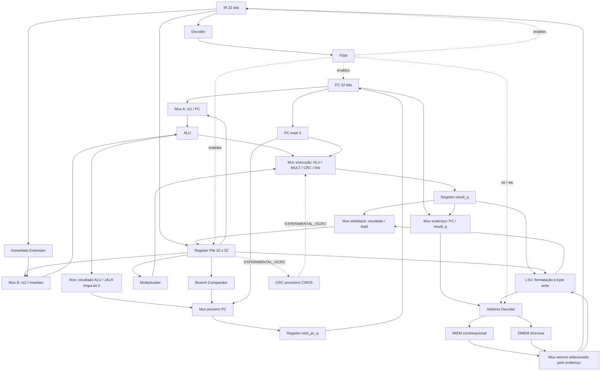

# Datapath integrado — subconjunto de 41 instruções

Fonte principal: Block Guide, seções 2–4, páginas físicas 9–23 do PDF combinado.

Figuras para o relatório, conferidas com o RTL em 2026-10-17:
[execução](figures/datapath-execution.svg), [memórias/PC](figures/datapath-memory.svg)
e [controle](figures/datapath-control.svg). Os três painéis usam redes nomeadas;
veja [fontes, reprodução e conferência](figures/README.md).

Dados, endereços e instruções são de 32 bits; funct3 tem 3 bits, seletores ALU/MULT
4 bits, endereços RF 5 bits e byte write 4 bits. O decoder gera as seleções; a FSM
habilita atualizações. Nenhum barramento de instruções separado ou pipeline.
CRC pontilhado está implementado e habilitado somente com `EXPERIMENTAL_XICRC=1`;
o [contrato provisório](crc_provisional.md) não confirma conformidade oficial.

## Sequência de execução

| Estado | Ação na borda final | Memória / escrita |
|---|---|---|
| FETCH (0) | IR captura dado em PC | oe ativo, PC retido |
| DECODE (1) | valida opcode/funct3/funct7 | leitura assíncrona de rs1/rs2 |
| EXECUTE (2) | registra resultado e próximo PC | calcula alvo/endereço efetivo |
| MEMORY (4), só load/store | DMEM registra leitura ou efetua escrita mascarada | endereço = result_q |
| WRITEBACK (3) | RF recebe resultado/load e PC recebe next_pc_q | load conserva endereço/oe; store não repete escrita |
| FAULT (5) | retém estado até reset | sem oe/we/writeback |

Instruções normais usam quatro ciclos; loads/stores, cinco. Reset síncrono leva
ao FETCH e endereço inicial. A política de FAULT é diagnóstico CMOS, não um
ambiente de exceções privilegiadas. Diagramas Mermaid estão versionados;
reprodução no ChipInventor para a submissão permanece um entregável separado.
