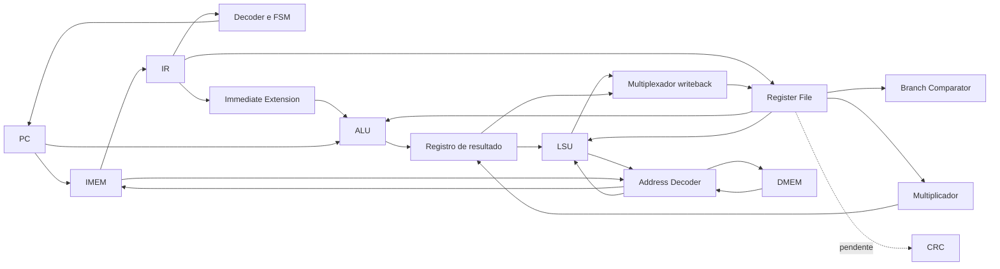

# Baseline v1 — organização

Fonte principal: Block Guide, seções 2–4, páginas físicas 9–23 do PDF combinado.

O desenho é arquitetural: IMEM é acessada por um único barramento via decoder,
tanto no fetch quanto em loads de constantes. Ligações diretas PC/IMEM e IMEM/IR
mostram o fluxo lógico. Diagramas Mermaid são versionados; reprodução no
ChipInventor para a submissão permanece um entregável separado.
