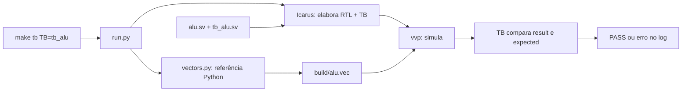

# Guia de leitura: como os arquivos se conectam

O perfil funcional possui **47 tipos de instrução** sob o
[contrato EEI CMOS](architecture/system.md). A imagem oficial exercita 44 tipos;
FENCE, ECALL e EBREAK têm testes próprios. Comece pela visão do sistema e abra
os blocos conforme os sinais aparecerem. A execução guiada está no
[laboratório](../labs/rtl-to-gds/README.md).
Se os papéis dos blocos ainda forem novos, leia primeiro a
[aula de arquitetura RISC-V](../labs/rtl-to-gds/00-arquitetura-riscv.md): ela
explica o datapath e o controle antes de acompanhar as instanciações no código.

## Ordem de leitura do hardware

| Arquivo | O que procurar |
|---|---|
| [simple_system.sv](../rtl/simple_system.sv) | Sistema reduzido: core, ROM, RAM e observação da assinatura |
| [riscv_top.sv](../rtl/riscv_top.sv) | Top parametrizável de validação, com commit e trap expostos |
| [riscv_core.sv](../rtl/riscv_core.sv) | Ligações do datapath, registradores intermediários e enables |
| [decoder.sv](../rtl/decoder.sv) | Qual operação executar: seletores, classes, illegal e pedido de trap |
| [control_unit.sv](../rtl/control_unit.sv) | Quando executar: sequência dos estados, falhas e traps terminais |
| [pc.sv](../rtl/pc.sv), [ir.sv](../rtl/ir.sv), [regfile.sv](../rtl/regfile.sv) | Estado arquitetural: PC atual, instrução capturada e registradores |
| [imm_ext.sv](../rtl/imm_ext.sv), [alu.sv](../rtl/alu.sv), [branch_comp.sv](../rtl/branch_comp.sv) | Imediato, resultado aritmético e condição de desvio |
| [multiplier.sv](../rtl/multiplier.sv), [crc.sv](../rtl/crc.sv) | Resultados combinacionais Zmmul/Xicrc, capturados em EXECUTE |
| [lsu.sv](../rtl/lsu.sv), [address_decoder.sv](../rtl/address_decoder.sv) | Formatação de bytes, alinhamento, seleção de região e retorno |
| [imem.sv](../rtl/imem.sv), [dmem.sv](../rtl/dmem.sv) | ROM combinacional, RAM síncrona e capacidades em palavras |

No core, siga `instruction → decode → a/b → resultado → result_q → writeback`.
O sufixo `_q` identifica armazenamento intermediário; `always @(posedge clk_i)`
altera estado na borda. `assign` e `always @*` descrevem lógica combinacional.
O PC só recebe `next_pc_q` em WRITEBACK; ele não avança em todo clock.

Para uma instrução ADD, o decoder escolhe os operandos do RF e a operação ADD.
EXECUTE captura a soma em `result_q`; WRITEBACK habilita a escrita em rd e o
avanço do PC. Os [contratos](architecture/interfaces.md) e o
[datapath](architecture/block_diagram.md) detalham as conexões.

## Da receita ao teste unitário



Cada linha de `alu.vec` contém `a b op expected`, em hexadecimal. O caso didático
`00000001 00000002 1 00000003` representa ADD de 1 e 2, esperando 3.
`tb_alu` lê os campos, aplica a/b/op ao DUT e usa `result !== expected` para
reprovar divergências, inclusive X/Z. O arquivo é uma lista de testes; quem
calcula a saída do circuito é o RTL executado pelo simulador.

O Makefile associa nomes às receitas. O Python prepara referências e chama
ferramentas. Icarus elabora RTL e TB; vvp executa a simulação. O executável
`build/tb_alu` é um modelo de simulação, não um processador fabricado.

## Programas e testes do processador

| Produtor | Arquivos gerados | Consumidor / aprovação |
|---|---|---|
| [isa.py](../scripts/sim/isa.py) | Palavras binárias e identificação de instruções | Biblioteca usada pelos geradores; não executa RTL |
| [programs.py](../scripts/sim/programs.py) | `isa.hex`, `isa.trace`, `isa_memory.vec`, `isa_counts.json` e `decoder.vec` | `tb_isa` compara cada aposentadoria e memória; `tb_decoder` confere controles |
| [crc_vectors.py](../scripts/sim/crc_vectors.py) e [crc_model.py](../scripts/sim/crc_model.py) | `crc.vec`, ROM/trace e memória CRC | `tb_crc` e `tb_core_crc` |
| [tb_core_system.prepare](../tb/integration/tb_core_system.sv) | Programa montado diretamente na ROM da bancada | `run_to_trap` verifica FENCE, efeitos anteriores e trap preciso |
| [run.py](../scripts/regression/run.py) | Logs e manifestos da execução selecionada | A regressão completa reúne TBs, lint e evidências da rodada |
| [coverage.py](../scripts/regression/coverage.py) | CSV, Markdown e XLSX | Exige trace, traps, firmware e hashes compatíveis antes de publicar |

O modelo Python registra **45 tipos que aposentam**. ECALL/EBREAK não entram
nessa contagem: os testes conferem eventos de trap. `decoder.trap_o` é um pedido
combinacional; `riscv_core.trap_o` é o nível que indica TRAP ativo. Com esse nível,
`trap_pc_o` informa o PC e `trap_ebreak_o` distingue ECALL=0 de EBREAK=1.
`commit_valid_o` fica baixo em TRAP. FAULT indica erro e é um estado distinto.

## Firmware próprio e imagem oficial

Nos programas próprios, `start.S` prepara pilha, copia `.data` da ROM para RAM,
zera `.bss` e chama `main.c`. `link.ld` fornece os endereços dessas regiões.
O script de build chama GCC para gerar ELF, objcopy para extrair o binário e
converte os bytes em palavras para `$readmemh`. O retorno de main em a0 é
publicado pelo startup; o testbench observa a execução real no core.

| Programa | Build / imagem | Protocolo de término |
|---|---|---|
| [smoke próprio](../firmware/smoke/README.md) | `build_firmware.py` → `smoke.hex`, ROM 16 KiB | SW de `600dc0de` em `10011ff0`, depois loop |
| [simple próprio](../firmware/simple/README.md) | `build_simple.py` → `simple.hex`, ROM 2 KiB | SW de `600dc0de` em `100103f0`; top gera done/success |
| [oficial](../firmware/official/README.md) | `build_official.py` converte `firmware.txt` verificado → `official.hex` | Escrita final de x4=0 e três commits no loop; falha é x4=FFFFFFFF |

O firmware oficial é usado como imagem publicada, sem recompilar assembly. Seu
conversor também gera tags e metadados para o TB. `READY` indica imagem preparada;
`PASS official_firmware` depende da simulação. O zero de x4 no reset não aprova.
No CRC, rs1 contém os dados e rs2 o acumulador; os wrappers C recebem `(seed,data)`
e colocam os operandos na ordem exigida pela instrução.

## Síntese e implementação física

`scripts/synth/simple.py` recebe RTL + ROM e chama Yosys. Depois compila a netlist
com `scripts/synth/tb_simple_netlist.sv` e verifica dois boots por pinos. A síntese
genérica não utiliza PDK nem fornece área física, timing ou GDSII.

`scripts/openlane/run_simple.py` verifica a evidência genérica, congela RTL/ROM/
configuração e chama LibreLane por Docker. Os alvos preparados permitem síntese,
floorplan ou fluxo completo; resultado parcial não comprova signoff. Veja os
[comandos de síntese](synthesis.md) e a [configuração física](../openlane/simple_system/README.md).
As execuções físicas da versão atual continuam a cargo do usuário.

## Leitura e prática

```bash
make help
make -n tb TB=tb_alu
make tb TB=tb_alu
make system
make official-fetch  # uma vez por clone, com revisão e SHA verificados
make official-run
make regression
```

Execute na raiz, um comando por vez. Consulte primeiro o comando de compilação,
depois o log de simulação. PASS do gerador não prova RTL correto. Uma alteração
de comentário também muda SHA-256: as [evidências arquivadas](verification.md)
continuam vinculadas aos arquivos de sua rodada e à tag `isa-47-v1`.
