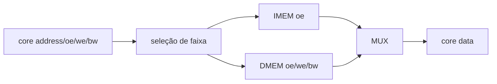

# Address Decoder
## Objetivo
Mapear IMEM/DMEM, Block Guide §4.4, PDF pp.22–23.
## Entradas
address/data[31:0], oe/we, bw[3:0], dados de ambas as memórias.
## Saídas
Endereço alinhado, dado de escrita, enables selecionados, bw DMEM, dado de retorno e fault.
## Comportamento
Faixas parametrizadas da baseline; decoder somente combinacional.
## Dependências
IMEM, DMEM e controles do core.
## Casos especiais
Sem escrita na IMEM, sem alias fora da faixa; endereço sem pedido não causa fault.
O endereço e oe de um load devem permanecer estáveis durante o writeback.
## Diagrama

## Testbench
tb_address_decoder e tb_memory_bus.
## Casos testados
768 combinações: fronteiras, bits baixos, pedidos e máscaras; proteção da ROM.
## Resultado
results/logs/tb_address_decoder.log e tb_memory_bus.log; regressão PASS.
## Integração
IMEM + DMEM + Address Decoder; leitura síncrona e escrita parcial verificadas.
## Commit validado
Tag block-address-decoder-v1.
## Pendências
Load/store no core; ChipInventor.
