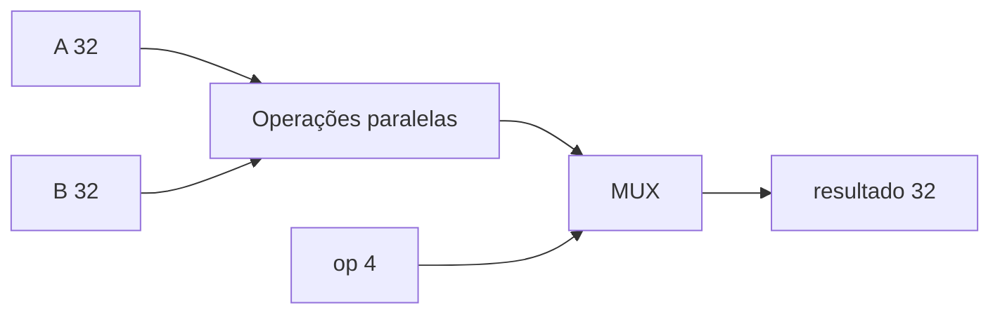

# ALU

## Objetivo
Operações combinacionais da tabela 9 do Block Guide, PDF pp.13–14.
## Entradas
a_i/b_i de 32 bits; op_i de 4 bits.
## Saídas
result_o de 32 bits.
## Comportamento
Códigos 0–A: PASS_B, ADD, SUB, AND, OR, XOR, SLL, SRL, SRA, SLT, SLTU.
## Dependências
Nenhuma.
## Casos especiais
Overflow modular de 32 bits, shift pelos 5 bits baixos; SLT/SRA signed.
Códigos não usados retornam zero; validação de instrução pertence ao decoder.
## Diagrama

## Testbench
tb/unit/tb_alu.sv, oracle Python scripts/sim/vectors.py.
## Casos testados
Zero, positivos/negativos, overflow, shift 0/31/32/33, limites signed/unsigned,
padrões alternados, comparação igual, códigos inválidos e 1000 pares aleatórios.
## Resultado
Consultar results/logs/tb_alu.log e lint.log; PASS necessário para a tag abaixo.
## Integração
tb/integration/tb_datapath.sv: mux de operandos e registro com write enable.
## Commit validado
Tag block-alu-v1.
## Pendências
Cobertura de instrução integrada depende do core; 0/47 neste marco.
Diagrama ChipInventor de submissão pendente.
