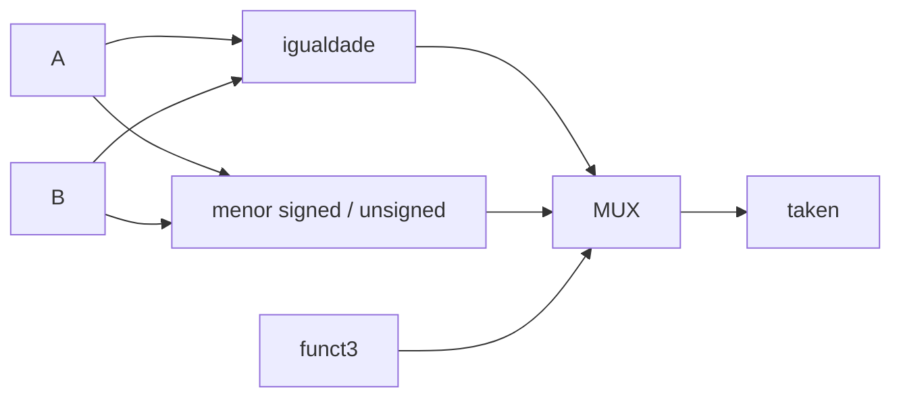

# Branch Comparator
## Objetivo
Comparação de branches; Block Guide §3.1.6, PDF pp.15–16.
## Entradas
a_i/b_i[31:0], funct3_i[2:0].
## Saídas
taken_o.
## Comportamento
BEQ/BNE/BLT/BGE/BLTU/BGEU conforme funct3 oficial.
## Dependências
Nenhuma.
## Casos especiais
BLT/BGE signed; BLTU/BGEU unsigned. Códigos reservados retornam falso.
## Diagrama

## Testbench
tb_branch_comp, vetores Python independentes.
## Casos testados
Iguais, positivos, negativos, limites e aleatórios, todas as condições.
## Resultado
results/logs/tb_branch_comp.log e regressão PASS.
## Integração
tb_branch_pc: Comparator + Immediate + ALU + PC, tomado/não tomado e alvo negativo.
## Commit validado
Tag block-branch-comp-v1.
## Pendências
Decode e integração de instruções de branch no core; ChipInventor.
