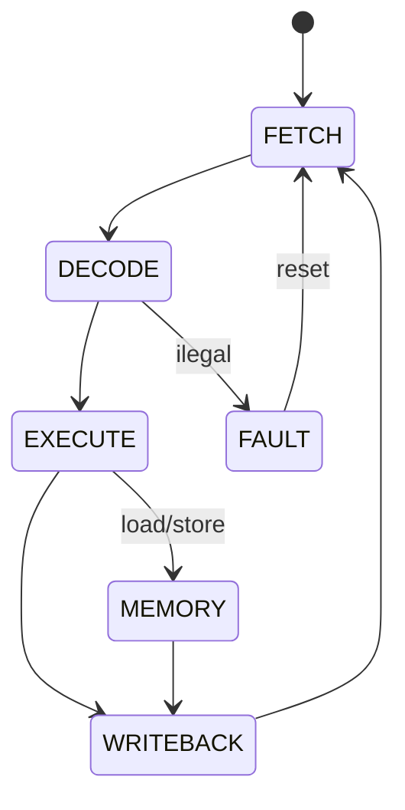

# Control Unit
## Objetivo
Sequenciar execução multiciclo, Block Guide §3.2, PDF p.16.
## Entradas
clk_i/rst_i, illegal_i, load_i/store_i e fault_i.
## Saídas
state_o[2:0], códigos em architecture/interfaces.md e RTL.
## Comportamento
FETCH → DECODE → EXECUTE → WRITEBACK. Loads/stores passam por MEMORY entre
EXECUTE e WRITEBACK. Erro entra em FAULT até reset.
## Dependências
Decoder informa legalidade; core informa erros de endereço.
## Casos especiais
Reset vence erro; instrução não suportada não chega ao writeback.
## Diagrama

## Testbench
tb_control_unit e tb_core_smoke.
## Casos testados
Sequência básica, load/store de cinco ciclos, erro de decode, erro externo,
retenção de erro e reset. tb_memory_faults verifica cancelamento de store no reset.
## Resultado
results/logs/tb_control_unit.log, tb_core_smoke.log e regressão PASS.
## Integração
Core instancia PC, IR, RF, Immediate e ALU. Primeira aposentadoria real.
## Commit validado
Tags core-smoke-v1 e isa-41-v1; evidências finais em rtl-subset-v0.1.
## Pendências
CRC/sistema aguardam definição oficial; ChipInventor.
