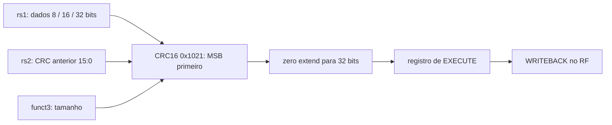

# CRC

## Objetivo
Executar CRCB/CRCH/CRCW conforme o [contrato oficial implementado](../architecture/crc.md).
Fonte: firmware edc7d599, recebido em 27/10/2026.

## Entradas
`a_i[31:0]`: dados (rs1); `b_i[31:0]`: CRC anterior (rs2, bits 15:0);
`op_i[3:0]`: 0/1/2 para 8/16/32 bits de dados.

## Saídas
`result_o[31:0]`: CRC16 estendido com zeros.

## Comportamento
Combinacional, polinômio 1021, bytes mais significativos selecionados primeiro,
MSB primeiro em cada byte, sem reflexão ou XOR final. O software inicia em FFFF;
o bloco atualiza o acumulador recebido, sem clock/reset interno.

## Dependências
Nenhuma no bloco. Decoder/core usam EXPERIMENTAL_XICRC=1 por padrão; o nome do
parâmetro foi mantido por compatibilidade. Valor 0 desabilita a extensão.

## Casos especiais
Op inválido retorna zero. Bits altos não selecionados são ignorados. O decoder
bloqueia funct3 inválido; x0 e aliases seguem o comportamento normal do RF.

## Diagrama

## Testbench
`tb_crc`, `tb_decoder`, `tb_core_crc`, `tb_isa`, `tb_simple_system` e `tb_official_firmware`.

## Casos testados
18.304 vetores; 123456789 → 29B1; mensagem oficial → 1E82 em três agrupamentos.
Core: 2.146 CRCs em 32.930 aposentadorias; rd=rs1/rs2, x0, memória e reset.
Firmware oficial completo: 16 CRCs e término real em x4. Decoder testa os dois perfis.

## Resultado
[Regressão de 27/10](../../results/experiments/crc-official-20261027/README.md):
32 TBs/lint PASS, firmware oficial PASS, teste negativo detecta o CRC anterior.

## Integração
Resultado de CRC selecionado e registrado em EXECUTE, writeback em WRITEBACK.
FSM e codificações preservadas. O perfil padrão tem 44/47 instruções verificadas.

## Commit validado
A rodada identificada possui hashes de RTL, modelo, testes, ROM e scripts em
regression.json e official_firmware.json. O commit de adequação será identificado no Git.

## Pendências
Síntese do CRC atualizado, área/timing e diagramas ChipInventor para submissão.
As três instruções de sistema e a interface física final são pendências separadas.
