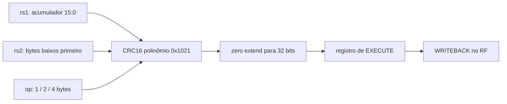

# CRC

## Objetivo
Executar CRCB/CRCH/CRCW no [contrato CMOS provisório](../architecture/crc_provisional.md).
Compatibilidade oficial Xicrc ainda não confirmada.

## Entradas
`a_i[31:0]`: acumulador; `b_i[31:0]`: dados; `op_i[3:0]`: 0/1/2 para byte/half/word.

## Saídas
`result_o[31:0]`: CRC16 estendido com zeros.

## Comportamento
Combinacional, polinômio 0x1021, bytes baixos primeiro, MSB primeiro em cada byte.
Estado inicial a_i[15:0], sem xor final. Sem clock/reset interno.

## Dependências
Nenhuma no bloco. Integração requer decoder/core com `EXPERIMENTAL_XICRC=1`.

## Casos especiais
Op inválido retorna zero. Bits altos do acumulador/dados não utilizados são ignorados.
O decoder bloqueia codificações inválidas; x0 e sobreposição seguem o RF normal.

## Diagrama

## Testbench
`tb_crc`, `tb_decoder` (duas configurações), `tb_core_crc`.

## Casos testados
18304 vetores: limites, zero, padrões, seed/dados aleatórios e op inválido.
Check ASCII `123456789 -> 29b1`. Programa integrado compara trace completo,
escrita real no RF, x0, rd=rs1/rs2, streams byte/word, store/load e reset.
O decoder varre 131072 combinações por configuração. Baseline rejeita CRC.

## Resultado
Evidências em `results/experiments/crc/`; regressão inclui a baseline anterior.

## Integração
Resultado selecionado no core e registrado em EXECUTE. FSM inalterada.
Programa/modelo em `scripts/sim/crc_vectors.py` e `crc_model.py`.

## Commit validado
Commit que introduz este módulo e `results/experiments/crc/regression.json`;
o manifesto identifica os conteúdos por SHA256.

## Pendências
P01 oficial aberta. Timing/área ainda não medidos; não marcar M7 oficial DONE.
