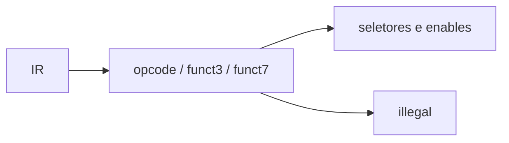

# Decoder
## Objetivo
Gerar controles a partir da instrução (RISC-V oficial e guia).
## Entradas
instr_i[31:0].
## Saídas
alu_op_o e seletores/enables descritos na baseline.
## Comportamento
Versão mínima reconhece ADD/SUB/ADDI; demais palavras ilegais.
## Dependências
ALU e FSM.
## Casos especiais
Checagem de funct3/funct7; ilegal desabilita RF.
## Diagrama

## Testbench
tb_core_smoke; teste exaustivo de decode adicionado com a cobertura de famílias.
## Casos testados
ADD, SUB, ADDI e dependências no core.
## Resultado
results/logs/tb_core_smoke.log.
## Integração
Decoder → muxes de operandos / RF / FSM.
## Commit validado
Tag core-smoke-v1.
## Pendências
Expansão por família, testes negativos de codificações e ChipInventor.
