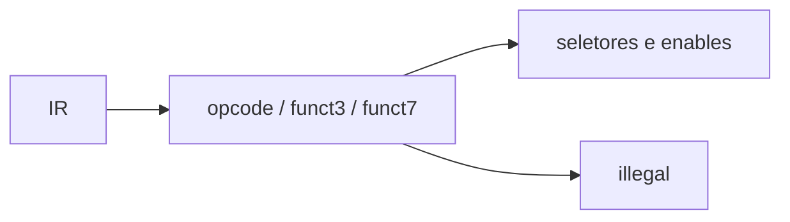

# Decoder
## Objetivo
Gerar controles a partir da instrução (RISC-V oficial e guia).
## Entradas
instr_i[31:0].
## Saídas
alu_op_o e seletores/enables descritos na baseline.
## Comportamento
Reconhece as instruções de docs/isa/enabled.json; demais palavras ilegais.
## Dependências
ALU e FSM.
## Casos especiais
Checagem de funct3/funct7; ilegal desabilita RF.
## Diagrama

## Testbench
tb_decoder: varredura opcode/funct3/funct7; tb_isa e tb_core_smoke.
## Casos testados
131072 combinações de campos, instruções válidas e inválidas; operandos limite
e aleatórios, x0 e sobreposição rd/rs1 no core.
## Resultado
results/logs/tb_core_smoke.log.
## Integração
Decoder → muxes de operandos / RF / FSM.
## Commit validado
Tags core-smoke-v1, isa-rtype-v1 e marcos seguintes em git log.
## Pendências
Expansão por família, testes negativos de codificações e ChipInventor.
