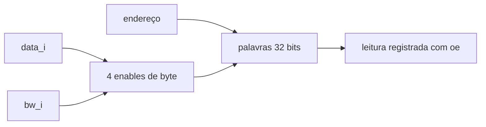

# DMEM
## Objetivo
Memória de dados, Block Guide §4.3, PDF p.21.
## Entradas
clk_i, address_i[31:0], oe_i/we_i, bw_i[3:0], data_i[31:0].
## Saídas
data_o[31:0].
## Comportamento
Leitura/escrita síncronas, padrão 8 KiB em 0x10010000. Read-first em simultâneo.
## Dependências
Decoder alinha endereço; LSU posiciona dado e byte write.
## Casos especiais
Sem reset de conteúdo. oe=0 retém saída; máscara zero preserva memória.
Faixa/alinhamento inválidos impedem escrita e leitura retorna zero.
## Diagrama

## Testbench
tb_dmem e tb_lsu_dmem.
## Casos testados
16 posições × 16 máscaras, read-first, saída retida, sem alias fora de faixa,
stores byte/half/word, preservação dos bytes e extensão signed.
## Resultado
results/logs/tb_dmem.log e tb_lsu_dmem.log; regressão PASS.
## Integração
LSU ↔ DMEM com latência de leitura real.
## Commit validado
Tag block-dmem-v1.
## Pendências
Core/decoder de endereços; macro SRAM física e ChipInventor na fase apropriada.
