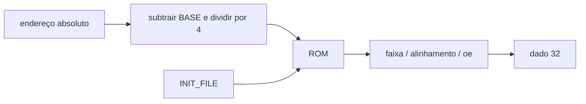

# IMEM
## Objetivo
ROM de instruções e constantes, Block Guide §4.2, PDF pp.20–21.
## Entradas
address_i[31:0] absoluto e oe_i. WORDS/BASE/INIT_FILE parametrizáveis.
## Saídas
data_o[31:0].
## Comportamento
Leitura combinacional de palavras de 32 bits. Padrão 4 MiB em 0x00400000.
## Dependências
Arquivo hex opcional, uma palavra little-endian por linha, preenchendo WORDS posições.
## Casos especiais
Fora da faixa, desalinhamento ou oe=0 retornam zero. Não existe porta de escrita.
Sem arquivo, posições são zero (instrução inválida). Com arquivo, os geradores
devem fazer padding explícito. Fontes exclusivas (arquivo OU zeros) preservam a
imagem na síntese; não inicializar com zeros antes de executar `$readmemh`.
## Diagrama

## Testbench
tb_imem e tb_fetch usam 8 palavras conhecidas; capacidade parametrizada explícita.
## Casos testados
Base, sequência, última palavra, limites, desalinhamento, oe e conteúdo de arquivo.
## Resultado
results/logs/tb_imem.log e tb_fetch.log; regressão PASS.
## Integração
PC + IMEM + IR + Immediate: endereços BASE até BASE+28 e retenção.
## Commit validado
Tag block-imem-v1.
Atualização de síntese: commit do simple_system e evidências em
`results/experiments/simple/`, incluindo execução da netlist com ROM embutida.
## Pendências
ROM física depende de firmware oficial e fluxo físico; ChipInventor pendente.
