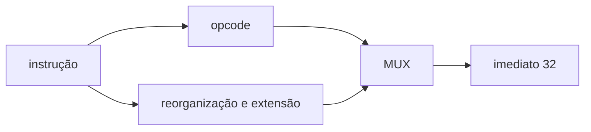

# Immediate Extension
## Objetivo
Reconstruir I/S/B/U/J; Block Guide §3.1.5 e manual RISC-V.
## Entradas
instr_i[31:0].
## Saídas
imm_o[31:0].
## Comportamento
Decodificação por opcode, concatenação e extensão de sinal combinacionais.
## Dependências
Nenhuma.
## Casos especiais
U conserva bits altos e zera baixos; B/J acrescentam zero no bit 0.
Opcode não reconhecido retorna zero.
## Diagrama

## Testbench
tb/unit/tb_imm_ext.sv; vetores codificados a partir de inteiros em Python.
## Casos testados
Positivo, negativo, zero, limites, bits individuais, 1000 aleatórios por formato.
## Resultado
results/logs/tb_imm_ext.log e regressão PASS.
## Integração
tb_rf_alu: imediato da instrução → ALU → RF.
## Commit validado
Tag block-imm-v1.
## Pendências
Diagrama ChipInventor para submissão.
