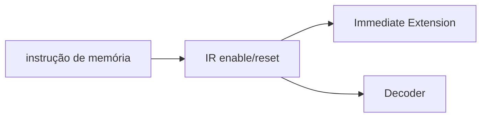

# Instruction Register
## Objetivo
Capturar a instrução em FETCH, Block Guide §3.1.4.
## Entradas
clk_i/rst_i/we_i, instr_i[31:0].
## Saídas
instr_o[31:0].
## Comportamento
Captura síncrona habilitada; reset zera, retenção quando desabilitado.
## Dependências
Fonte de instruções e controle de fetch.
## Casos especiais
Reset tem prioridade. Zero pós-reset não é executado: FETCH precede DECODE.
## Diagrama

## Testbench
tb_ir e tb_ir_imm.
## Casos testados
64 pares captura/retenção, reset e estabilidade durante execução.
## Resultado
results/logs/tb_ir.log; regressão PASS.
## Integração
IR → Immediate → ALU.
## Commit validado
Tag block-ir-v1.
## Pendências
Diagrama ChipInventor para submissão.
