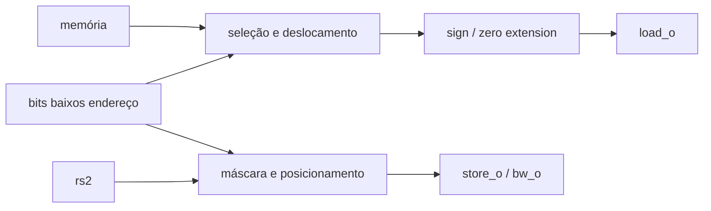

# Load/Store Unit
## Objetivo
Reformatar loads/stores conforme Block Guide §3.3, PDF pp.16–19.
## Entradas
address_i, store_i, mem_i[31:0], funct3_i[2:0], is_store_i.
## Saídas
load_o/store_o[31:0], bw_o[3:0], misaligned_o e invalid_o.
## Comportamento
Little-endian, seleção de lane, sign/zero extension e máscara de escrita.
## Dependências
ALU fornece endereço efetivo; memória fornece palavra alinhada.
## Casos especiais
LW/SW alinhados em 4, LH/LHU/SH em 2. Inválido/desalinhado zera saídas e bw;
core deve sinalizar FAULT. Somente bytes selecionados do store são enviados.
## Diagrama

## Testbench
tb_lsu usa modelo de bytes Python.
## Casos testados
Todos funct3, offsets 0–3, valores com MSB 0/1, máscaras e alinhamentos inválidos.
## Resultado
results/logs/tb_lsu.log e regressão PASS.
## Integração
tb_lsu_rf: ALU → LSU → RF; store lane verificado antes da DMEM.
## Commit validado
Tag block-lsu-v1.
## Pendências
Integração com DMEM e core no próximo marco; ChipInventor.
