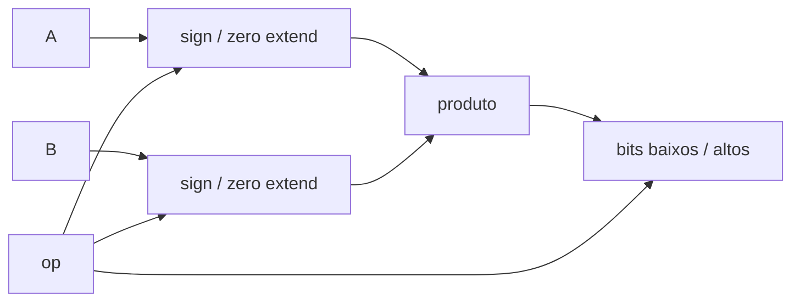

# Multiplicador
## Objetivo
Zmmul conforme tabelas 7 e 10, PDF pp.11–12,14.
## Entradas
a_i/b_i[31:0], op_i[3:0].
## Saídas
result_o[31:0].
## Comportamento
0=MUL, 1=MULH, 2=MULHSU, 3=MULHU. Combinacional, partes baixa/alta.
## Dependências
Nenhuma.
## Casos especiais
Extensão independente para operandos signed/unsigned (33 bits), produto de 66
bits com seleção dos bits arquiteturais [31:0]/[63:32]. Inválido retorna zero.
## Diagrama

## Testbench
tb_multiplier; aritmética Python de precisão arbitrária.
## Casos testados
Zero, um, -1, extremos signed/unsigned, combinações mistas, aleatórios e inválidos.
## Resultado
results/logs/tb_multiplier.log; regressão PASS.
## Integração
tb_mult_rf verifica seleção do produto e escrita no banco.
## Commit validado
Tag block-multiplier-v1; integração ISA em marco seguinte.
## Pendências
Integração de decode/core; ChipInventor.
