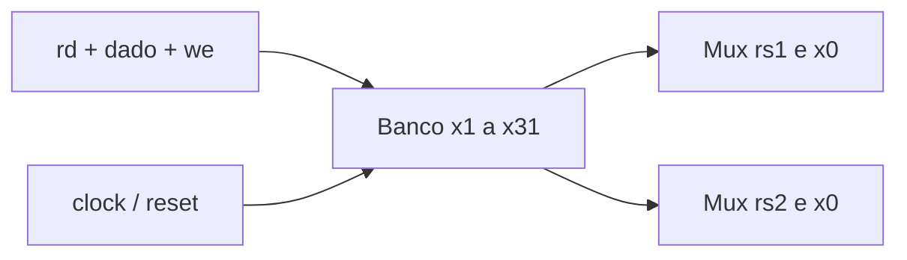

# Register File
## Objetivo
Banco 32×32, Block Guide §3.1.4, PDF p.15.
## Entradas
clk_i/rst_i/we_i; rs1_i/rs2_i/rd_i[4:0]; data_i[31:0].
## Saídas
a_o/b_o[31:0].
## Comportamento
Duas leituras assíncronas, escrita na subida do clock. Reset síncrono CMOS.
## Dependências
Nenhuma.
## Casos especiais
x0 não possui armazenamento; escrita descartada, leituras sempre zero.
Reset tem prioridade sobre escrita; sem bypass antes da borda.
## Diagrama

## Testbench
tb/unit/tb_regfile.sv.
## Casos testados
32 destinos, 1024 pares de leitura, x0, retenção, leitura após escrita, reset.
## Resultado
results/logs/tb_regfile.log; regressão e lint devem passar para a tag.
## Integração
tb/integration/tb_rf_alu.sv conecta RF → ALU → RF com operações dependentes.
## Commit validado
Tag block-regfile-v1.
## Pendências
Integração no core concluída em isa-41-v1; diagrama ChipInventor de submissão pendente.
