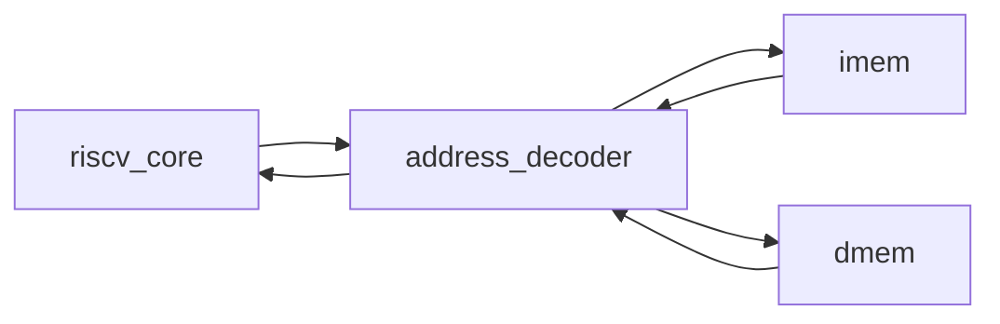

# Top de integração
## Objetivo
Integrar core, address decoder e memórias do Block Guide.
## Entradas
clk_i/rst_i; parâmetros IMEM_WORDS, DMEM_WORDS e IMEM_FILE.
## Saídas
fault_o e commit_* para observação. Não são pinagem física definitiva.
## Comportamento
Barramento unificado de instruções e dados; ROM combinacional e RAM síncrona.
## Dependências
riscv_core, address_decoder, imem, dmem.
## Casos especiais
Reset não apaga DMEM, mas bloqueia escrita. FAULT persiste até reset.
## Diagrama

## Testbench
tb_isa e tb_memory_faults; testbench de firmware próprio previsto.
## Casos testados
Instruções habilitadas, memória por byte, stores únicos, limites, loads de ROM,
erros sem efeitos colaterais e reset durante store.
## Resultado
results/logs/tb_isa.log e tb_memory_faults.log; regressão PASS.
## Integração
Top executável de simulação; sem dependência Ibex.
## Commit validado
Tag isa-37-v1.
## Pendências
CRC, sistema, firmware oficial, pinagem UART/GPIO, ChipInventor e fluxo físico.
