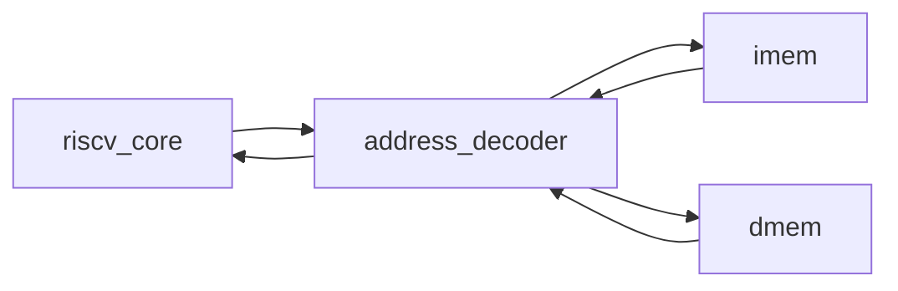

# Top de integração
## Objetivo
Integrar core, address decoder e memórias do Block Guide.
## Entradas
clk_i/rst_i; parâmetros IMEM_WORDS, DMEM_WORDS, IMEM_FILE e EXPERIMENTAL_XICRC (padrão 1).
## Saídas
fault_o, commit_* e trap_o/trap_ebreak_o/trap_pc_o para observação e EEI.
Não são pinagem física definitiva. [Contrato de traps](../architecture/system.md).
## Comportamento
Barramento unificado de instruções e dados; ROM combinacional e RAM síncrona.
## Dependências
riscv_core, address_decoder, imem, dmem.
## Casos especiais
Reset não apaga DMEM, mas bloqueia escrita. FAULT persiste até reset.
## Diagrama

## Testbench
tb_isa, tb_memory_faults e tb_firmware (C/assembly compilados), além de tb_core_crc
com EXPERIMENTAL_XICRC=1; tb_core_system verifica FENCE/ECALL/EBREAK.
## Casos testados
Instruções habilitadas, memória por byte, stores únicos, limites, loads de ROM,
erros sem efeitos colaterais e reset durante store.
## Resultado
results/logs/tb_isa.log e tb_memory_faults.log; regressão PASS.
## Integração
Top executável de simulação; sem dependência Ibex.
## Commit validado
Tag isa-41-v1; firmware e documentação finais em rtl-subset-v0.1.
## Pendências
Pinagem UART/GPIO, ChipInventor e fluxo físico. CRC, sistema e firmware oficial
passam na tag isa-47-v1 (47 tipos em testes próprios, 44 na imagem oficial).
Para síntese experimental com memórias pequenas, usar [simple_system](simple_system.md),
conforme [roteiro](../synthesis.md).
