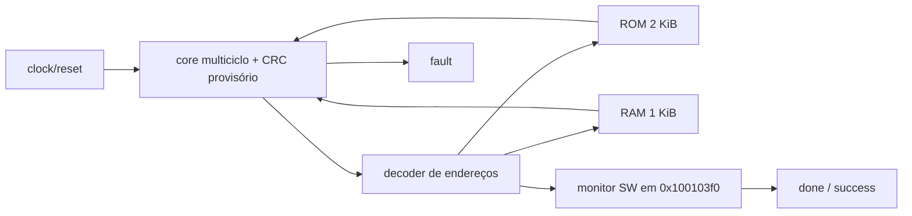

# simple_system — experimento CMOS

## Objetivo
Executar firmware próprio com core/CRC provisório num sistema pequeno, verificável
por pinos e síntese lógica. Não é o top final da competição.

## Entradas
`clk_i`: borda de subida; `rst_i`: síncrono, ativo alto.
Parâmetro `ROM_FILE`, padrão `build/simple.hex`.

## Saídas
- `done_o`: primeira escrita SW no endereço de assinatura foi observada.
- `success_o`: essa assinatura foi 0x600dc0de; interpretar somente com done.
- `fault_o`: erro do core, retido até reset.

Não há timeout interno; TB impõe 10000 ciclos. Após done, firmware permanece
em loop e o clock do core continua ativo. Done/success ficam retidos até reset.

## Comportamento

| Região | Endereço | Capacidade / contrato |
|---|---|---|
| ROM | 0x00400000–0x004007ff | 512 palavras, 2 KiB, combinacional |
| RAM | 0x10010000–0x100103ff | 256 palavras, 1 KiB, leitura síncrona, escrita por byte |
| Pilha inicial | 0x100103e0 | cresce para baixo, reserva mínima de 256 bytes |
| Assinatura na RAM | 0x100103f0 | somente SW completa encerra o programa |

Bases preservadas, capacidades reduzidas somente neste experimento. `riscv_top`
e o smoke original mantêm suas capacidades. Linker separa dados/BSS/pilha e os
últimos 32 bytes. O endereço da assinatura não é um novo periférico/MMIO.

Reset limpa core e saídas, suprime escrita e reinicia PC. RAM não é zerada:
startup copia `.data` da ROM e limpa `.bss` em cada boot. Monitor ignora SB/SH.
Done não substitui fault: são estados observáveis separados.

## Dependências
Core com `EXPERIMENTAL_XICRC=1`, decoder de endereços, IMEM e DMEM.
Firmware em `firmware/simple/`; [contrato CRC](../architecture/crc_provisional.md).

## Diagrama


## Casos especiais e memórias
ROM vira lógica constante no Yosys; trocar firmware exige nova síntese, não
carregar um arquivo no chip em execução. O gerador preenche exatamente 512
palavras. IMEM inicializa por arquivo OU zeros, evitando sobrescrever a imagem
durante síntese. RAM vira registradores/multiplexadores sem inicialização.
Isso não comprova viabilidade de área/timing em SKY130A; macros e capacidades
finais precisam de avaliação própria.

O smoke original usa assinatura 0x10011ff0, fora desta RAM. Use `simple.hex`.
Não há UART/GPIO nem instruções de sistema presumidas.

## Testbench
`tb_simple_system` e `scripts/synth/tb_simple_netlist.sv`.

## Casos testados
Boot com RAM indefinida, reboot em RAM suja, reset cancelando SW de assinatura,
retenção de saídas, SB sem término, assinatura ruim, instrução ilegal e recuperação.
Firmware testa dados/BSS/pilha, MUL, escritas parciais e CRCB/CRCH/CRCW.
Netlist: dois boots observando somente pinos, sem acesso interno à ROM/RAM.

## Resultado
[Evidências e limites](../../results/experiments/simple/README.md).

## Integração
Parte da regressão, sem ampliar `docs/isa/enabled.json`.

```bash
make simple-firmware  # compila e gera a ROM
make simple-system    # simula RTL, reset e falhas
make simple-synth     # síntese Yosys e teste da netlist genérica
make regression       # baseline + CRC + simple_system + lint
```

Síntese verifica ausência de memória não mapeada, inicialização de registradores
e saídas constantes. Não utiliza PDK, restrições de timing ou fluxo físico.
Passo a passo: [aula 7](../../labs/rtl-to-gds/07-sintese.md).
Consulta de comandos e saídas: [síntese](../synthesis.md).

## Commit validado
Commit que inclui este documento e `results/experiments/simple/regression.json`;
os hashes do manifesto identificam os conteúdos testados.

## Pendências
Configuração física experimental, área/timing, revisão das memórias. CRC oficial,
sistema/sincronização, firmware oficial e interface final continuam pendentes.
