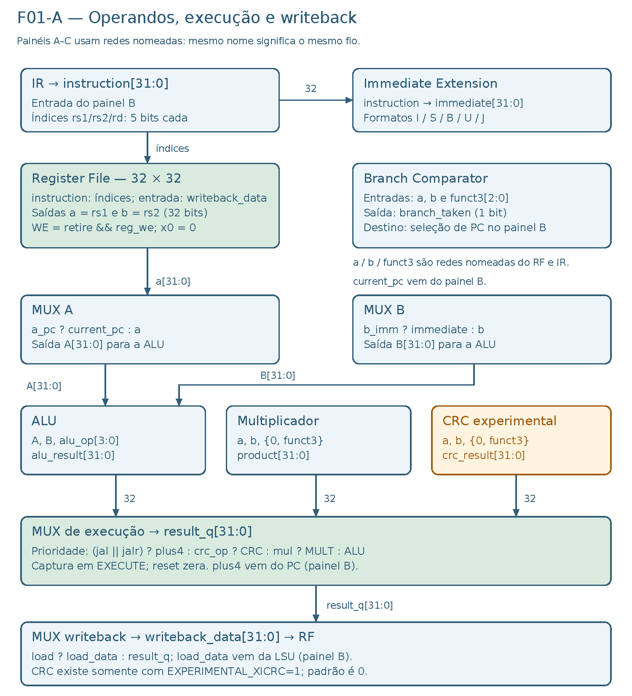
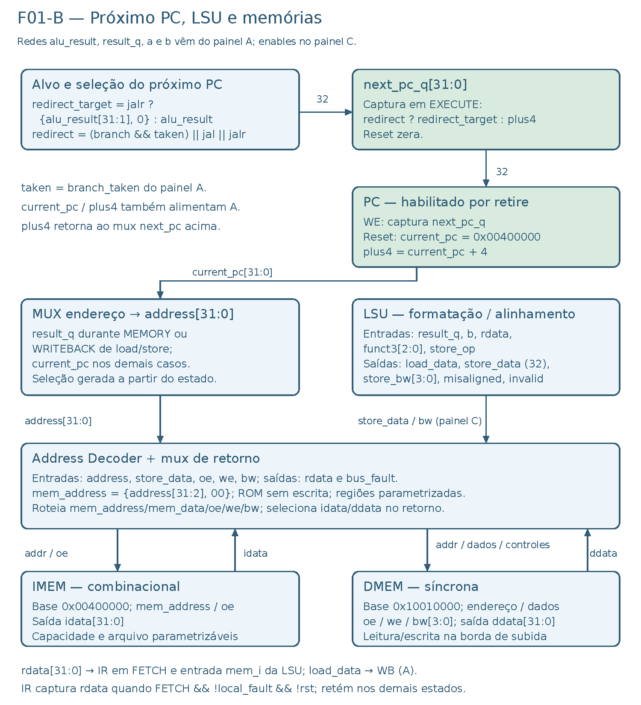
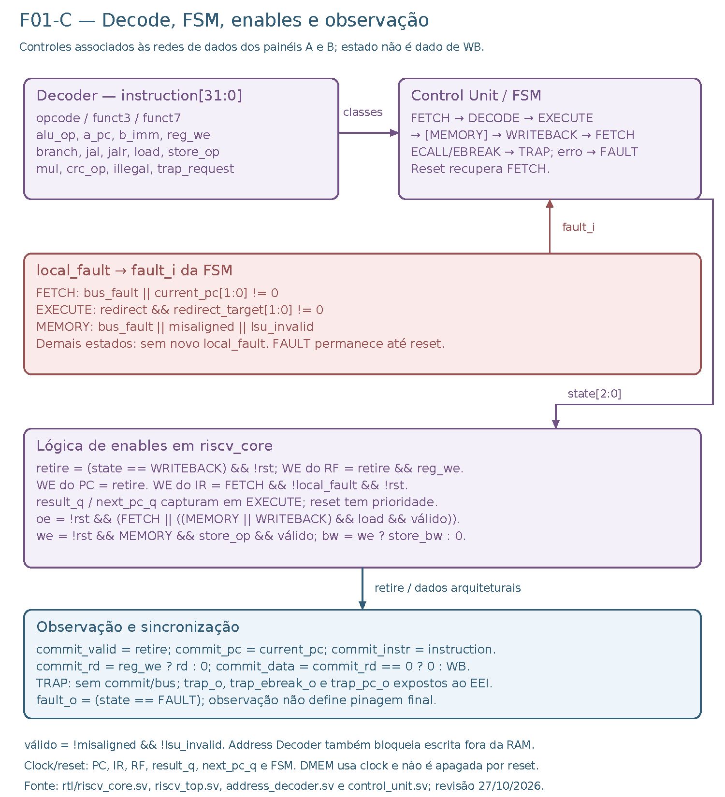
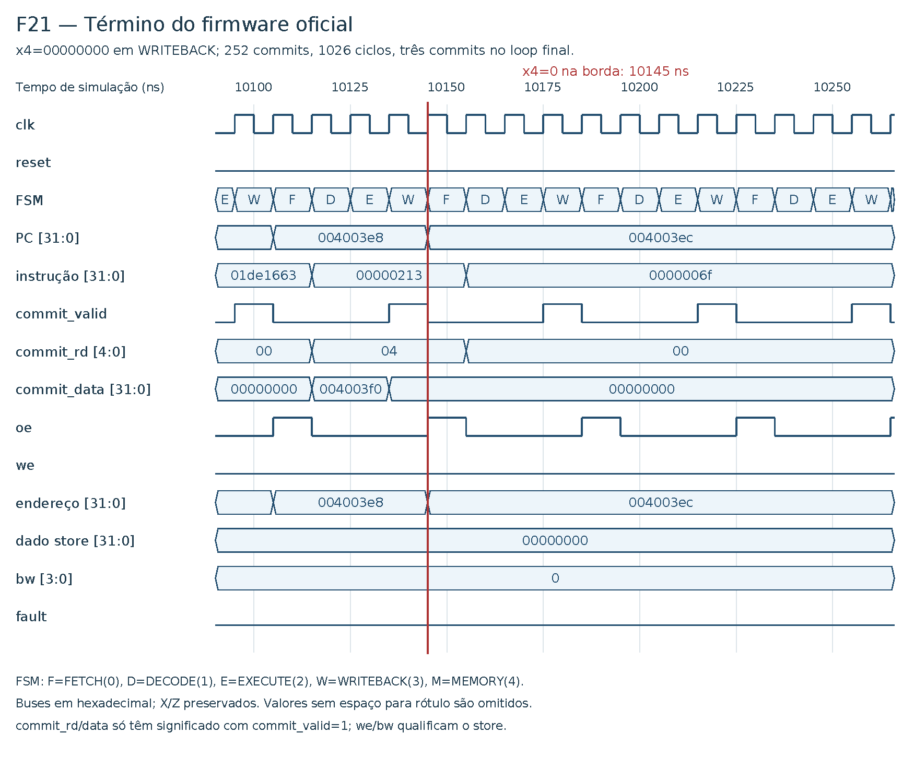

# CMOS RISC-V — Relatório técnico da Fase 2

**Versão preliminar 0.7 — 27 de outubro de 2026**

Equipe: CMOS. Integrantes, instituição e orientador: **a preencher**.
Repositório: cmosuea-arch/RV32-multicycle. Rodada atual: 27/10, hashes em [R4].
Captura própria histórica: RTL `7ddc6bf`, identificada em [R6].
Estrutura conforme os tópicos 1–6 do Guia de Submissão [R1].

## 1. Visão Geral do Projeto

### 1.1 Objetivo e arquitetura

Implementar em SystemVerilog um processador RISC-V de 32 bits, multiciclo,
conforme o Block Guide ChampionCHIP: RV32I, Zmmul e Xicrc, com meta de
47 instruções. A implementação é própria, sem incorporar o core Ibex.

`riscv_core` integra PC, IR, banco de registradores, imediatos, decoder, ALU,
comparador de branch, multiplicador, LSU e controle. `riscv_top` conecta o núcleo
a IMEM, DMEM e decoder de endereços. A configuração padrão verifica **47/47
instruções (100%)**, incluindo CRCB/CRCH/CRCW conforme o firmware oficial.
O parâmetro histórico `EXPERIMENTAL_XICRC` vale 1 por padrão [R2, R3].

A execução segue `FETCH → DECODE → EXECUTE → WRITEBACK`. Loads/stores acrescentam
MEMORY para a DMEM síncrona. O PC atualiza na aposentadoria; reset síncrono ativo
alto, na borda de subida, reinicia em `0x00400000`. Acessos inválidos ou instruções
não suportadas levam a FAULT até reset, sem implementar traps privilegiados.

| Memória | Base | Capacidade padrão | simple_system experimental |
|---|---|---|---|
| IMEM, leitura combinacional | 0x00400000 | 4 MiB | 2 KiB |
| DMEM, acesso síncrono | 0x10010000 | 8 KiB | 1 KiB |

A organização de bytes é little-endian. A IMEM também fornece constantes;
a DMEM aceita escrita por byte e não é apagada por reset. `simple_system`
usa Xicrc e saídas done/success/fault para verificar firmware próprio.
Pinos/periféricos e implementação das memórias do top final seguem pendentes.

### 1.2 Desenvolvimento e ferramentas

O desenvolvimento parte dos contratos de interface, reset e memória. Cada
bloco passa por implementação, TB autoverificável, integração e regressão antes
do próximo incremento. Marcos: **21/47** (aritmética), **29/47** (controle de
fluxo), **37/47** (memória) e **41/47** (Zmmul), identificados pelas tags
`isa-21-v1`, `isa-29-v1`, `isa-37-v1` e `isa-41-v1`.

Python gera referências, vetores e programas; Icarus compila/simula RTL e TB;
GCC/binutils geram o firmware RV32I_Zmmul/ILP32; Verilator realiza lint. Make
coordena os comandos. Logs e hashes SHA-256 identificam o conteúdo verificado.
Os vetores são determinísticos; firmware compilado complementa os programas
gerados pelo modelo Python [R2, R4].

A rodada de 27/10 aprovou 33 TBs e lint dos dois tops. O firmware oficial
concluiu a validação e sua captura VCD foi conferida. A síntese genérica
histórica antecede a correção do CRC; a nova síntese e o fluxo físico ficam
para execução pelo usuário [R3–R7].

<!-- pagebreak -->

## 2. Instruções Suportadas

### 2.1 Cobertura e lista por categoria

| Categoria | Esperadas | Implementadas | Cobertura | Instruções da baseline |
|---|---|---|---|---|
| Arithmetic and Logic (Register) | 10 | 10 | 100% | ADD, SUB, SLL, SLT, SLTU, XOR, SRL, SRA, OR, AND |
| Arithmetic and Logic (Immediate) | 9 | 9 | 100% | ADDI, SLTI, SLTIU, XORI, ORI, ANDI, SLLI, SRLI, SRAI |
| Load | 5 | 5 | 100% | LB, LH, LW, LBU, LHU |
| Store | 3 | 3 | 100% | SB, SH, SW |
| Branch | 6 | 6 | 100% | BEQ, BNE, BLT, BGE, BLTU, BGEU |
| Jump | 2 | 2 | 100% | JAL, JALR |
| Upper Immediate | 2 | 2 | 100% | LUI, AUIPC |
| Sistema / Sincronização | 3 | 3 | 100% | FENCE, ECALL, EBREAK (EEI CMOS) |
| Multiplication | 4 | 4 | 100% | MUL, MULH, MULHSU, MULHU |
| CRC | 3 | 3 | 100% | CRCB, CRCH, CRCW |
| **Total** | **47** | **47** | **100%** | **Perfil integrado e verificado** |

**Firmware oficial:** 44 tipos de instrução exercitados, com término real em x4.
FENCE, ECALL e EBREAK usam testes próprios sob o EEI CMOS. Os nomes vêm do
manual RV32I referenciado pelo Block Guide; a imagem oficial não as exercita.

A contagem exige decode, execução integrada e regressão, com evidência por
instrução em [R3]. ECALL/EBREAK geram traps precisos, sem aposentadoria;
o ambiente CMOS encerra a execução até reset, sem implementar CSRs.

### 2.2 Convenções das codificações

Os campos das tabelas seguintes estão em binário. O traço indica campo não
usado como discriminador; seus bits podem fazer parte do imediato. Em shifts
imediatos, funct7 discrimina a operação e shamt tem cinco bits. PASS_B é uma
operação interna da ALU, sem acrescentar instrução à cobertura.

As 47 codificações implementadas foram conferidas com
`docs/isa/coverage.csv`. A matriz contém testes, firmware oficial, marco Git e
caminho da evidência por instrução; versões Markdown/Excel acompanham o CSV.

<!-- pagebreak -->

### 2.3 Codificação — aritmética e imediatos

| Instrução | Opcode [6:0] | Funct3 [14:12] | Funct7 [31:25] |
|---|---|---|---|
| ADD | 0110011 | 000 | 0000000 |
| SUB | 0110011 | 000 | 0100000 |
| SLL | 0110011 | 001 | 0000000 |
| SLT | 0110011 | 010 | 0000000 |
| SLTU | 0110011 | 011 | 0000000 |
| XOR | 0110011 | 100 | 0000000 |
| SRL | 0110011 | 101 | 0000000 |
| SRA | 0110011 | 101 | 0100000 |
| OR | 0110011 | 110 | 0000000 |
| AND | 0110011 | 111 | 0000000 |
| ADDI | 0010011 | 000 | — |
| SLTI | 0010011 | 010 | — |
| SLTIU | 0010011 | 011 | — |
| XORI | 0010011 | 100 | — |
| ORI | 0010011 | 110 | — |
| ANDI | 0010011 | 111 | — |
| SLLI | 0010011 | 001 | 0000000 |
| SRLI | 0010011 | 101 | 0000000 |
| SRAI | 0010011 | 101 | 0100000 |
| LUI | 0110111 | — | — |
| AUIPC | 0010111 | — | — |

SLT/SLTI comparam com sinal; SLTU/SLTIU, sem sinal. O imediato I é estendido
com sinal inclusive em SLTIU. Deslocamentos por registrador usam rs2[4:0].
LUI forma o imediato U; AUIPC soma esse imediato ao PC da instrução.

<!-- pagebreak -->

### 2.4 Codificação — memória, controle de fluxo e multiplicação

| Instrução | Opcode [6:0] | Funct3 [14:12] | Funct7 [31:25] |
|---|---|---|---|
| BEQ | 1100011 | 000 | — |
| BNE | 1100011 | 001 | — |
| BLT | 1100011 | 100 | — |
| BGE | 1100011 | 101 | — |
| BLTU | 1100011 | 110 | — |
| BGEU | 1100011 | 111 | — |
| JAL | 1101111 | — | — |
| JALR | 1100111 | 000 | — |
| LB | 0000011 | 000 | — |
| LH | 0000011 | 001 | — |
| LW | 0000011 | 010 | — |
| LBU | 0000011 | 100 | — |
| LHU | 0000011 | 101 | — |
| SB | 0100011 | 000 | — |
| SH | 0100011 | 001 | — |
| SW | 0100011 | 010 | — |
| MUL | 0110011 | 000 | 0000001 |
| MULH | 0110011 | 001 | 0000001 |
| MULHSU | 0110011 | 010 | 0000001 |
| MULHU | 0110011 | 011 | 0000001 |

### 2.5 Codificação — Xicrc

| Instrução | Opcode [6:0] | Funct3 [14:12] | Funct7 [31:25] |
|---|---|---|---|
| CRCB | 0110011 | 000 | 1000000 |
| CRCH | 0110011 | 001 | 1000000 |
| CRCW | 0110011 | 010 | 1000000 |

O firmware oficial define rs1=dados, rs2=CRC anterior e bytes mais significativos
primeiro dentro dos 8/16/32 bits selecionados. CRC16/CCITT-FALSE usa polinômio
1021, sem reflexão/XOR final, resultado estendido com zeros e seed FFFF por
software. A mensagem 12 34 56 78 90 AB CD EF resulta em 1E82 nos três tamanhos;
ASCII 123456789 resulta em 29B1. RTL/modelo/firmware próprio foram adequados [R3, R7].

### 2.6 Codificação — sistema/sincronização

| Instrução | Opcode [6:0] | Funct3 [14:12] | Palavra / campos adicionais |
|---|---|---|---|
| FENCE | 0001111 | 000 | fm/pred/succ; exemplo 0x0ff0000f |
| ECALL | 1110011 | 000 | Palavra exata 0x00000073 |
| EBREAK | 1110011 | 000 | Palavra exata 0x00100073 |

FENCE preserva a ordem serial sem escrita. Traps expõem trap_o, trap_ebreak_o
(0=ECALL, 1=EBREAK) e trap_pc_o. Não há retorno de trap neste EEI [R2, R3].

<!-- pagebreak -->

## 3. Datapath

### 3.1 Operandos, execução e writeback

Os três painéis foram conferidos com o RTL em 27/10/2026. Nomes iguais
identificam a mesma rede entre blocos/painéis. Fontes vetoriais: [R2].



**Figura F01-A.** Muxes selecionam operandos e resultado; result_q captura em
EXECUTE; writeback escolhe resultado ou load. CRC é opcional, habilitado por padrão com o contrato oficial.

<!-- pagebreak -->

### 3.2 Próximo PC, LSU e memórias



**Figura F01-B.** O alvo de JALR tem bit 0 zerado. next_pc_q captura o próximo
endereço; PC atualiza em retire. A LSU formata loads/stores e gera byte write.
O decoder seleciona a memória e protege a ROM. Endereço de dados é conservado
em MEMORY e WRITEBACK de load/store; o store não repete escrita em WRITEBACK.

<!-- pagebreak -->

### 3.3 Controle e sincronização



**Figura F01-C.** Decoder gera seleções/classes; FSM e lógica do core geram
enables e oe/we/bw. Instruções sem acesso a dados usam quatro ciclos;
loads/stores, cinco. ECALL/EBREAK entram em TRAP sem commit; trap_* informa
PC/motivo ao EEI. FAULT indica erro. Ambos retêm estado até reset; os sinais
de observação não definem a pinagem final.

<!-- pagebreak -->

## 4. Módulos e Testbenches

### 4.1 Datapath básico e multiplicação

Arquivos: `rtl/<módulo>.sv`, `docs/modules/<módulo>.md` e bancadas em `tb/`.
Dados são de 32 bits; índices RF, de 5 bits. Os testes abaixo possuem resultados
PASS na rodada identificada em [R4]. Os diagramas ChipInventor por módulo serão
incorporados após sua entrega pelo colaborador responsável.

| Módulo | Função | TB principal | Casos verificados |
|---|---|---|---|
| alu | 11 operações combinacionais; seletor de 4 bits | tb_alu | 18.304 vetores; extremos, overflow modular, shifts e signed/unsigned |
| regfile | 32×32; duas leituras combinacionais, escrita síncrona; x0 fixo | tb_regfile | Escrita/leitura, 1.024 pares, x0, enable e reset |
| imm_ext | Reconstrução e extensão dos formatos I/S/B/U/J | tb_imm_ext | 5.102 vetores; extremos, bits e sinal |
| pc | Endereço atual e PC+4; atualização habilitada e reset | tb_pc | Sequência, retenção, alvos, wrap e reset |
| ir | Captura habilitada em FETCH e retenção da instrução | tb_ir | Captura/retenção, sequência e reset |
| imem | ROM combinacional parametrizável; arquivo completo ou zeros | tb_imem | Conteúdo, enable, alinhamento e limites |
| branch_comp | Igualdade e ordem signed/unsigned conforme funct3 | tb_branch_comp | 9.152 vetores; limites e condições tomadas/não tomadas no core |
| multiplier | Partes baixa/alta de produtos signed, mixed e unsigned | tb_multiplier | 18.304 vetores; zero, -1, extremos e quatro operações Zmmul |

Integrações progressivas: `tb_rf_alu`, `tb_ir_imm`, `tb_fetch`, `tb_pc_alu`,
`tb_branch_pc`, `tb_datapath` e `tb_mult_rf`. Elas verificam conexões e enables
antes da execução completa no core. A especificação detalhada de entradas,
saídas, dependências e casos especiais permanece em [R2].

**Diagramas a inserir nesta seção:** F02–F08 e F14, produzidos no ChipInventor,
com pinos e larguras legíveis. Os painéis podem agrupar módulos relacionados.

<!-- pagebreak -->

### 4.2 Memória, controle e integração

| Módulo | Função | TB principal | Casos verificados |
|---|---|---|---|
| lsu | Seleção/extensão de loads; posicionamento/máscara de stores | tb_lsu | 8.960 vetores; byte/half/word, offsets, sinal e alinhamento |
| dmem | Leitura/escrita síncronas; preserva bytes não selecionados | tb_dmem | 256 combinações posição/máscara, read-first e limites |
| address_decoder | Seleção IMEM/DMEM, retorno, controles e proteção da ROM | tb_address_decoder | 768 combinações faixa/pedido/máscara |
| decoder | Decodifica opcode/funct3/funct7; Xicrc habilitado | tb_decoder | 131.138 palavras por perfil; SYSTEM exatas/vizinhas e demais campos |
| control_unit | FSM multiciclo com FAULT e TRAP terminais | tb_control_unit | Transições, classes, falhas e reset |
| crc | CRC-16 Xicrc combinacional; 1/2/4 bytes | tb_crc | 18.304 vetores e respostas 29B1/1E82 |
| riscv_core | Integra execução, controle e barramento compartilhado | tb_isa; tb_core_system | PC/RF por aposentadoria; FENCE ordenada e traps precisos |
| riscv_top | Liga core, decoder de endereços e memórias | tb_official_firmware; tb_memory_faults | Firmware, acessos e bloqueio de efeitos inválidos |
| simple_system | Sistema pequeno com CRC e saídas de término/sucesso/falha | tb_simple_system | Nove cenários de boot/reset/assinatura/falha/trap |

**Resultado agregado:** 14 TBs unitários + 19 de integração e lint PASS em
27/10/2026. `tb_isa`: 88.794 aposentadorias, 46 stores e 12 bytes finais.
CRC integrado: 2.146 CRCs em 32.930 aposentadorias. O teste negativo com o
CRC anterior produziu a falha oficial na rodada histórica. Sistema: 512 FENCE,
256 ECALL e 256 EBREAK, sem efeitos posteriores e com reset. Sem síntese [R4, R7].

Python gera referências determinísticas; o TB encerra com erro em divergência.
O executor rejeita falha, timeout, diagnóstico de compilação ou ausência de PASS.
Verilator verifica largura/latches/loops sem suprimir essas classes. Manifestos
identificam cada rodada por SHA-256. São testes funcionais, sem prova formal
ou alegação de cobertura exaustiva de código/operandos.

**Diagramas a inserir:** F09–F13 e F15–F18. O diagrama CRC deve indicar o contrato
oficial de dados/acumulador e o simple_system deve ser identificado como experimento.

<!-- pagebreak -->

## 5. Resultados OpenLane

**Fluxo físico do processador pendente.** O ambiente LibreLane/SKY130A foi
verificado com um exemplo até GDSII; os resultados desse exemplo não representam
o CMOS RISC-V [R5]. Preencher a tabela com uma única execução final identificada.

| Campo | Resultado do processador |
|---|---|
| Commit RTL, top e configuração | Pendente |
| Ferramentas/PDK, clock e restrições | Pendente |
| Área total e densidade final | Não medidas |
| Timing, DRC/LVS e antena | Não avaliados |
| GDSII, GL, config.json e imagem F19 | Pendentes |

**Síntese preparatória histórica (CRC anterior):** simple_system passou no Yosys 0.39+124 (`d73f71e81`),
com 32.922 células genéricas e dois boots simulados na netlist. ROM virou
constantes; RAM, registradores/muxes. A inicialização da IMEM foi corrigida para
selecionar arquivo OU zeros após detectar ROM zerada na síntese. O teste da
netlist confirmou a correção. Não há área física ou timing medidos nessa rodada [R5].

## 6. Firmware Demo

### 6.1 Firmware próprio e evidência disponível

`start.S` configura a pilha, copia .data, limpa .bss e chama `main.c`; `link.ld`
posiciona código/dados. GCC/binutils geram RV32I_Zmmul/ILP32. O programa testa
boot, dados, pilha, chamadas, loops, memória e multiplicação. O startup escreve
o retorno em `0x10011ff0`; o TB confere a assinatura e a palavra da RAM.

Execução isolada de 17/10/2026, RTL `7ddc6bf`, com VCD/logs/hashes em [R6]:

```text
PASS firmware: signature 600dc0de, 598 retirements, 2579 cycles
```

O experimento simple_system também executa firmware próprio com os três CRCs;
usa assinatura em `0x100103f0`, ROM 2 KiB e RAM 1 KiB, e passou nos nove cenários RTL atuais. A netlist de referência é histórica [R4, R5].

### 6.2 Firmware oficial

**PASS na simulação RTL**, revisão upstream edc7d599. Imagem publicada de
259 palavras, incluindo constantes, carregada na IMEM sem remontagem. O TB
exige a escrita final de x4=0 e três commits no loop; o zero do reset não aprova.
Resumo do log completo e hashes em [R7]:

```text
PASS official_firmware: x4=00000000, 252 retirements, 1026 cycles,
CRC=16, ISA=44, terminal loop verified
```

<!-- pagebreak -->

### 6.3 Waveform do firmware oficial



**Figura F21 — Janela de 10.090–10.266 ns da captura de 27/10/2026.**
Na borda de **10.145 ns**, WRITEBACK conclui a instrução no PC 004003E8,
escrevendo x4=0. O TB confirma o RF e observa três commits do loop em 004003EC;
fault permanece zero. A execução total tem 252 commits, 1026 ciclos e 16 CRCs.

O traçado vem das mudanças reais do VCD, com escala 1 ps/tick e clock do TB de
10 ns. A conferência usa valores anteriores à borda, antes dos NBAs, e reconcilia
VCD/log em ciclos, commits, CRCs e término. Não mede frequência máxima física.
Captura, logs e verificação estão em [R7]. As figuras e o VCD do firmware próprio
continuam preservados em [R6] como apoio ao vídeo, fora deste PDF.

<!-- pagebreak -->

### 6.4 Referências e evidências

**[R1] ChampionCHIP, 2026, versão 1.0.**
[Guia de Submissão e Block Guide](../../Champion-chip-guia-fase-2.pdf),
páginas físicas 2–4 e 6–23. Limite: PDF de 20 páginas. Hash e conferência dos
requisitos: [conformidade.md](conformidade.md).

**[R2] Arquitetura e método.** [AGENTS.md](../../AGENTS.md),
[interfaces](../architecture/interfaces.md), [mapa](../architecture/memory_map.md),
[decisões](../architecture/decisions.md), [pendências oficiais](../architecture/official_questions.md),
[esclarecimentos de 20/10](../architecture/clarifications_20261020.md),
[módulos](../modules/), [datapath](../architecture/block_diagram.md) e
[fontes das figuras](../architecture/figures/README.md).

**[R3] ISA.** [Matriz CSV](../isa/coverage.csv), [versão legível](../isa/coverage.md),
[contrato CRC](../architecture/crc.md), [EEI CMOS](../architecture/system.md) e
[matriz experimental](../isa/experimental_crc.md).

**[R4] Verificação.** [Alcance dos testes](../verification.md),
[manifesto da rodada completa](../../results/experiments/isa-47-20261027/logs/regression.json),
[evidências ISA atuais](../../results/experiments/isa-47-20261027/README.md),
[Makefile](../../Makefile), [roteiro](../testing_roadmap.md) e
[laboratório](../../labs/rtl-to-gds/README.md).

**[R5] Síntese e ambiente físico.** [Registro simple_system](../../results/experiments/simple/README.md),
[resumo Yosys](../../results/experiments/simple/simple_synth.json),
[log da netlist](../../results/experiments/simple/simple_netlist.log) e
[smoke do ambiente](../../results/openlane/environment-smoke.md).

**[R6] Captura própria, 17/10/2026.**
[Registro](../../results/experiments/firmware-wave/README.md),
[snapshot/hashes](../../results/experiments/firmware-wave/capture.json),
[verificação do VCD](../../results/experiments/firmware-wave/waveform.json),
[log](../../results/experiments/firmware-wave/tb_firmware.wave.log) e
[VCD comprimido](../../results/experiments/firmware-wave/smoke.vcd.gz).

Os manifestos comprovam os conteúdos das respectivas rodadas. O fechamento da
entrega deve vincular código, testes, firmware e resultados físicos ao commit
final. Autoria, diagramas ChipInventor e resultados físicos ainda devem ser
incorporados e revisados antes da submissão.

**[R7] Firmware oficial e validação, 27/10/2026.**
[Origem/revisão/hashes](../../firmware/official/source.json),
[registro da rodada](../../results/experiments/isa-47-20261027/README.md),
[log oficial](../../results/experiments/isa-47-20261027/logs/tb_official_firmware.log),
[verificação do VCD](../../results/experiments/isa-47-20261027/waveform.json) e
[VCD comprimido](../../results/experiments/isa-47-20261027/official.vcd.gz).
