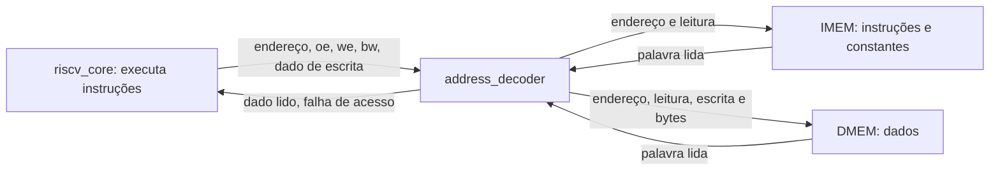
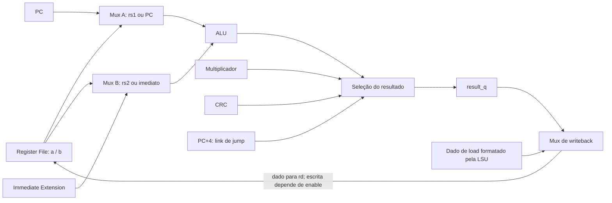

# 0 — Arquitetura RISC-V: dos blocos à execução de uma instrução

[Índice](README.md) · [Próxima: ambiente e ferramentas](01-visao-geral.md)

## Objetivo e forma de estudar

Entender como os blocos compõem **o nosso processador**, antes de acompanhar os
códigos e o fluxo de testes. Comece pelo sistema completo e abra suas partes.
Ao terminar, você deve conseguir seguir uma instrução desde a memória até seu
resultado, explicando quem fornece os dados e quem autoriza cada atualização.

Esta aula é de leitura e previsão. Os comandos de prática ao final são opcionais;
ela não exige alterar RTL, limpar builds ou executar síntese. Abra também o
[diagrama do projeto](../../docs/architecture/block_diagram.md) e o
[guia de leitura dos arquivos](../../docs/code_guide.md).

## 1. RISC-V, processador e sistema

RISC-V é uma **arquitetura de conjunto de instruções**, ou ISA: um contrato sobre
as operações que o software pode pedir ao hardware. Por exemplo, ADD determina
uma soma entre registradores. O nome RISC-V, por si só, não define nossa FSM,
a quantidade de ciclos nem as capacidades de ROM/RAM.

Nossa implementação usa registradores e dados de 32 bits, base RV32I, multiplicação
Zmmul e CRC customizado Xicrc. O [perfil integrado](../../docs/isa/coverage.md)
possui 47 tipos de instrução sob o [ambiente CMOS](../../docs/architecture/system.md).
O firmware oficial exercita 44 deles; testes próprios cobrem os três de sistema.

| Camada | O que representa neste projeto |
|---|---|
| ISA | Operações e codificações que o programa utiliza |
| Microarquitetura | Como organizamos datapath, registradores e FSM para executá-las |
| Core | Circuito que busca, decodifica e executa instruções |
| Sistema | Core conectado a memórias, decodificação de endereços e observação |
| Firmware | Sequência de instruções que esse circuito executa |
| Testbench | Ambiente de simulação que estimula e verifica o circuito |

### Core, top e simple_system

[riscv_core.sv](../../rtl/riscv_core.sv) contém o núcleo, sem IMEM/DMEM internas.
[riscv_top.sv](../../rtl/riscv_top.sv) instancia esse núcleo e as memórias, com
capacidades parametrizáveis e sinais de observação. Já
[simple_system.sv](../../rtl/simple_system.sv) integra os mesmos tipos de blocos
em um sistema reduzido: ROM 2 KiB, RAM 1 KiB e saídas done/success/fault.

**riscv_top e simple_system são dois tops alternativos.** simple_system não
instancia riscv_top; cada um conecta sua própria instância do core às memórias.
O sistema reduzido é a entrada do experimento de síntese da aula 7.



O desenho mostra as funções dos blocos. No RTL, os dois tipos de acesso usam o
mesmo barramento do core, em momentos distintos: FETCH acessa instruções;
MEMORY acessa os dados de load/store.

## 2. Quais informações o núcleo precisa guardar?

O programa possui registradores x0–x31. Os nomes rs1/rs2 identificam fontes e rd
identifica destino; eles são **índices**, não os valores armazenados. Por exemplo,
rs1=1 seleciona x1; o dado lido de x1 pode ser 5, 100 ou qualquer padrão de 32 bits.
Cada índice tem cinco bits, suficientes para selecionar um dos 32 registradores.
x0 sempre fornece zero. No nosso [regfile](../../rtl/regfile.sv), apenas x1–x31
ocupam armazenamento e a leitura de x0 é forçada a zero.

Além desses registradores, observe os registros usados pelo datapath multiciclo:

| Registro / sinal | O que guarda | Quando muda neste core |
|---|---|---|
| PC / `current_pc` | Endereço da instrução atual | Reset ou WRITEBACK |
| IR / `instruction` | Palavra da instrução buscada | Reset ou borda final de FETCH |
| Register File | Valores dos registradores do programa | Reset ou WRITEBACK com escrita habilitada e rd diferente de x0 |
| `result_q` | Resultado ou endereço efetivo calculado | Reset ou borda final de EXECUTE |
| `next_pc_q` | Endereço que o PC receberá ao concluir | Reset ou borda final de EXECUTE |

`result_q` e `next_pc_q` são armazenamento interno da implementação: o programa
não os acessa como x1/x2. Eles permitem conservar o cálculo até a etapa seguinte.
Os sufixos `_i` e `_o` indicam entrada/saída de um módulo; `_q` indica estado
registrado. Os fios que ligam módulos não são, por esse motivo, novos registradores.

## 3. Datapath: por onde passam os dados?

O **datapath** reúne os caminhos que transportam, selecionam, calculam e guardam
valores. Um multiplexador, ou mux, escolhe uma de suas entradas conforme um sinal
de controle. No core, a ALU pode receber rs1 ou PC em A, e rs2 ou imediato em B.



É um recorte dos caminhos de cálculo; o [datapath completo](../../docs/architecture/block_diagram.md)
inclui busca, memória e próximo PC. As entradas de multiplicação/CRC também vêm
do Register File, como você verá nas instanciações do core.

| Bloco | Papel e ligação principal |
|---|---|
| [PC](../../rtl/pc.sv) | Mantém o endereço usado na busca; fornece também PC+4 |
| [IMEM](../../rtl/imem.sv) | Fornece a palavra no endereço solicitado; também permite loads de constantes |
| [IR](../../rtl/ir.sv) | Conserva a instrução para decoder, imediato e índices do RF |
| [Register File](../../rtl/regfile.sv) | Lê dois operandos e recebe a escrita de rd |
| [Immediate Extension](../../rtl/imm_ext.sv) | Reconstrói o imediato dos formatos I/S/B/U/J |
| [ALU](../../rtl/alu.sv) | Faz lógica/aritmética e é reutilizada para calcular endereços e alvos |
| [Branch Comparator](../../rtl/branch_comp.sv) | Compara rs1 e rs2; informa se a condição de branch é verdadeira |
| [Multiplicador](../../rtl/multiplier.sv) | Calcula resultado Zmmul para a seleção de execução |
| [CRC](../../rtl/crc.sv) | Calcula CRC16 com dados em rs1 e acumulador anterior em rs2 |
| [LSU](../../rtl/lsu.sv) | Formata loads/stores, seleciona bytes e verifica alinhamento |
| [Address Decoder](../../rtl/address_decoder.sv) | Seleciona a memória e roteia controles, retorno e falha de acesso |
| [DMEM](../../rtl/dmem.sv) | Armazena dados, com leitura/escrita síncronas e máscara de bytes |

Os blocos combinacionais podem produzir valores continuamente. O resultado só
passa a valer como atualização do programa quando os enables permitem gravá-lo.
Uma soma correta na saída da ALU não comprova, sozinha, que o processador escreveu
o registrador certo ou avançou para a instrução correta.

## 4. Controle: quem escolhe a operação e o momento?

O [decoder](../../rtl/decoder.sv) identifica a instrução e fornece seletores/classes:
ADD, load, store, branch, multiplicação, CRC ou pedido de trap. A
[FSM](../../rtl/control_unit.sv) sequencia os estados. O core combina estado e
controles para habilitar IR, PC, RF e memória.

| Sinal no core | Quem fornece | Uso |
|---|---|---|
| `alu_op` | Decoder | Escolhe a operação da ALU |
| `a_pc` / `b_imm` | Decoder | Selecionam PC em A e imediato em B |
| `reg_we` | Decoder | Informa que a instrução tem resultado para rd |
| `state` | FSM | Indica em qual etapa a instrução está |
| `retire` | Core: WRITEBACK sem reset | Autoriza concluir a instrução e atualizar PC |
| `retire && reg_we` | Core | Habilita escrita no RF; o próprio RF protege x0 |
| `oe_o` / `we_o` / `bw_o` | Core/LSU | Pedem leitura, escrita e seleção de bytes no barramento |

Há **dois decodificadores com funções diferentes**: `decoder.sv` interpreta bits
da instrução; `address_decoder.sv` interpreta o endereço para selecionar memória.
Nenhum deles substitui a FSM.

### Por que multiciclo?

Nossa FSM executa uma instrução por vez, reutilizando recursos em vários clocks.
Isso é uma escolha da implementação CMOS, não uma regra imposta a todo RISC-V.

| Estado | O que acontece até a borda final |
|---|---|
| FETCH | PC endereça a ROM; IR captura a instrução se o acesso for válido |
| DECODE | Decoder valida a palavra; RF fornece operandos e o imediato fica disponível |
| EXECUTE | Caminhos combinacionais calculam; `result_q` e `next_pc_q` capturam os valores |
| MEMORY, só load/store | A RAM registra a leitura ou realiza o store na borda |
| WRITEBACK | Load ou resultado vai para rd se aplicável; PC recebe `next_pc_q`; instrução aposenta |

ADD/ADDI e outras operações sem acesso a dados usam quatro ciclos; load/store
usam cinco. Para um store, a escrita já ocorreu em MEMORY: WRITEBACK conclui e
avança o PC sem repetir a escrita nem alterar o RF. Não existem instruções
diferentes ocupando esses estados ao mesmo tempo; este core não tem pipeline.

**Combinacional e sequencial:** a ALU reage às entradas sem aguardar clock.
PC/IR/RF e os registros intermediários mudam na borda de subida quando habilitados.
O reset síncrono ativo alto tem prioridade; no nosso projeto a RAM não é apagada
por reset, e o startup do firmware prepara seus dados antes de usá-los. O reset
reinicia o PC em `0x00400000` e zera os registradores do programa.

## 5. Acompanhe uma ADD do programa até o registrador

Considere `ADD x3,x1,x2`, com x1=1 e x2=2. A palavra é `0x002081b3`:

```text
funct7   rs2    rs1    funct3  rd     opcode
0000000  00010  00001  000     00011  0110011
```

Opcode/funct3/funct7 identificam a operação. Os índices selecionam x1/x2/x3.
Os números 1 e 2 somados vêm do RF; não estão embutidos como dados nessa palavra.

Suponha PC=`0x00400008` ao começar a busca:

| Etapa | Ligações e valores relevantes |
|---|---|
| FETCH | PC → Address Decoder → IMEM → retorno `data_i` → IR; captura `002081b3` |
| DECODE | IR → decoder; rs1=1/rs2=2 → RF; a=1 e b=2 |
| EXECUTE | `a_pc=0`, `b_imm=0`, `alu_op=1`: ALU soma; `result_q` recebe 3 e `next_pc_q` recebe `0040000c` |
| WRITEBACK | `retire=1` e `reg_we=1`: RF grava x3=3; PC recebe `0040000c` |

Veja duas conexões reais de `riscv_core.sv`:

```systemverilog
// Controles escolhem os dados que chegam à ALU.
alu arithmetic(a_pc?current_pc:a,b_imm?immediate:b,alu_op,alu_result);

// Fontes/destino são campos do IR; a escrita exige estado e tipo de instrução.
regfile register_file(clk_i,rst_i,retire&&reg_we,
    instruction[19:15],instruction[24:20],instruction[11:7],writeback_data,a,b);
```

Na instância da ALU, os argumentos seguem a ordem das portas declaradas em
`alu.sv`: a_i, b_i, op_i e result_o. O valor `alu_op=1` é o seletor interno da
soma; ele é diferente do opcode da instrução. No RF, `rs1_i/rs2_i` recebem os
índices e `a_o/b_o` fornecem os dados. Confira a declaração das portas em
`regfile.sv` para acompanhar cada posição dessa instanciação.

Se x1/x2 contiverem outros valores, a mesma instrução executará outra soma.
Em `tb_core_smoke`, por exemplo, x1=5 e x2=-3: essa ADD deve gravar x3=2.
O padrão de 32 bits de -3 é `fffffffd`; a soma descarta o carry além de 32 bits.

## 6. O que muda nas outras instruções?

### ADDI: o segundo dado vem da instrução

Em `ADDI x3,x1,2`, o RF fornece x1 e o Immediate Extension fornece 2.
`b_imm=1` escolhe o imediato para a ALU. O resultado segue o mesmo armazenamento
em EXECUTE e a escrita em WRITEBACK. Imediatos negativos passam por extensão de
sinal; a montagem dos bits pertence ao Immediate Extension.

### Load/store: endereço e dado são coisas diferentes

Suponha x1=`0x10010000`, x3=3 e execute `SW x3,4(x1)`:

1. O imediato é 4; a ALU calcula x1+4=`0x10010004` e registra em `result_q`.
2. rs2 seleciona x3; a LSU recebe esse dado e produz a escrita formatada.
3. O Address Decoder identifica DMEM; `we_o` e `bw_o=1111` permitem gravar os
   quatro bytes na borda final de MEMORY.
4. WRITEBACK avança o PC; esse store não tem escrita de rd.

Agora `LW x5,4(x1)` reutiliza o cálculo de endereço. Em MEMORY, a DMEM registra
a leitura. O retorno passa pela LSU e, em WRITEBACK, `load_data` é escolhido para
gravar x5=3. O endereço e o enable de leitura permanecem válidos nessa etapa.
Para LB/LH/LBU/LHU, a LSU seleciona os bytes e estende sinal ou zeros.

Os endereços externos são em **bytes**. A base da IMEM é `00400000` e a da DMEM
é `10010000`; cada palavra tem quatro bytes. A LSU usa os bits baixos para
selecionar bytes, e o decoder de endereços entrega a palavra alinhada à memória.
Consulte o [mapa de memória](../../docs/architecture/memory_map.md) para os limites
de cada configuração. RF, IMEM e DMEM são armazenamentos com papéis distintos.
Na organização little-endian, a word `00000003` é armazenada como bytes
`03 00 00 00`, em endereços crescentes. A ordem dos bytes do cálculo CRC é
definida pela instrução e não altera essa organização da memória.

### Branch/jump: escolher qual instrução vem depois

Em `BEQ x3,x5,8`, o Branch Comparator decide se os valores são iguais.
A ALU calcula **PC da instrução + imediato**, selecionando PC em A.
O core escolhe entre alvo e PC+4 e guarda a escolha em `next_pc_q`.
O PC só muda na conclusão. O comparador, sozinho, não escreve o PC.

JAL/JALR também escolhem um novo PC e gravam PC+4 como endereço de retorno em rd.
Por isso, o resultado de writeback de um jump e seu endereço de destino percorrem
caminhos diferentes. JALR calcula o alvo a partir de rs1 e limpa seu bit zero.

### Multiplicação, CRC e sistema

Multiplicador e CRC são caminhos de execução paralelos à ALU. Os controles
`mul`/`crc_op` escolhem qual resultado será registrado; RF e WRITEBACK continuam
sendo compartilhados. O [CRC](../../docs/architecture/crc.md) recebe dados em rs1,
CRC anterior em rs2 e devolve um CRC16 estendido com zeros.

FENCE preserva a ordem dos acessos no sistema serial e aposenta sem escrever RF.
ECALL/EBREAK entram em TRAP e não aposentam. Erros entram em FAULT. Ambos os
estados terminais retêm a execução até reset; `trap_o`, `trap_ebreak_o` e
`trap_pc_o` informam o pedido ao ambiente. O [contrato CMOS](../../docs/architecture/system.md)
define esse tratamento, sem implementar serviços de sistema ou CSRs.

## 7. Como essa arquitetura orienta os testes?

Um teste unitário pode provar que a ALU soma corretamente, mas não verifica a
seleção dos operandos, o destino no RF ou o PC. A integração precisa observar
essas conexões e a sequência da FSM. `commit_valid_o` indica a aposentadoria;
`commit_pc_o/commit_instr_o/commit_rd_o/commit_data_o` descrevem sua conclusão.
Um store deve ser conferido também pela escrita física da memória.

| Pergunta sobre o circuito | Teste que fornece evidência |
|---|---|
| PC busca a palavra certa e IR a conserva? | [tb_fetch](../../tb/integration/tb_fetch.sv) |
| O RF fornece os operandos e recebe o resultado da ALU? | [tb_rf_alu](../../tb/integration/tb_rf_alu.sv) |
| Decoder/FSM executam instruções e suas dependências no core? | [tb_core_smoke](../../tb/integration/tb_core_smoke.sv) |
| A LSU posiciona dados e preserva bytes da RAM? | [tb_lsu_dmem](../../tb/integration/tb_lsu_dmem.sv) |
| PC, instrução, destino e resultado coincidem com a referência? | [tb_isa](../../tb/integration/tb_isa.sv), com trace Python |
| FENCE e traps respeitam efeitos anteriores e bloqueiam posteriores? | [tb_core_system](../../tb/integration/tb_core_system.sv) |
| O software executa até o protocolo de término? | [tb_firmware](../../tb/integration/tb_firmware.sv) e [tb_official_firmware](../../tb/integration/tb_official_firmware.sv) |

### Prática opcional: prever antes de executar

Leia `tb_core_smoke.sv` e preveja os cinco resultados: x1=5, x2=`fffffffd`,
x3=2, x4=8 e x0=0. A tentativa de escrever x0 deve ser ignorada. Depois siga,
um comando por vez, os testes de conexão abaixo:

```bash
make tb TB=tb_fetch
make tb TB=tb_rf_alu
make tb TB=tb_core_smoke
make tb TB=tb_lsu_dmem
make system
```

Localize no testbench o ponto de comparação e o timeout. Não é preciso executar
toda a regressão para estudar esta aula; o percurso completo está no
[roteiro da prática](00-pratica-para-video.md).

## 8. Exercício e critério de avanço

Explique com suas próprias palavras, consultando os arquivos apenas depois:

1. Se a ALU calculou 3, por que x3 pode continuar com o valor antigo?
2. Qual é a diferença entre o decoder da instrução e o de endereços?
3. Por que load precisa de MEMORY nesta implementação?
4. Quem decide se um BEQ é tomado e quem permite atualizar o PC?
5. Como rs2 pode selecionar outro registrador sem mudar o opcode?
6. Por que o teste de ECALL não deve aguardar um commit normal?

**Respostas para conferência:** a escrita exige WRITEBACK, enable e destino
válido; os decoders interpretam instrução e endereço, respectivamente; a DMEM
é síncrona; Branch Comparator decide a condição, o core seleciona o alvo e a
aposentadoria habilita o PC; rs2 é um campo de índice separado da operação;
ECALL produz trap preciso e não aposentadoria.

Avance quando conseguir desenhar PC → busca → IR → controle/operandos → cálculo
→ resultado → RF/próximo PC, e explicar onde entram load/store. Na
[aula 1](01-visao-geral.md), você ligará esse circuito ao testbench, Python e Make.

## Referências

- ChampionCHIP, Block Guide, §§2–4 do [PDF local](../../Champion-chip-guia-fase-2.pdf):
  arquitetura multiciclo, módulos e mapa; o guia tem prioridade no projeto.
- [Manual RV32I v2.1](https://docs.riscv.org/reference/isa/v20260120/unpriv/rv32.html):
  registradores, campos e comportamento das instruções; consultado em 27/10/2026.
- [Interfaces CMOS](../../docs/architecture/interfaces.md),
  [decisões de implementação](../../docs/architecture/decisions.md) e
  [datapath](../../docs/architecture/block_diagram.md): sinais e temporização desta versão.

Os diagramas desta aula são esquemas didáticos das conexões do RTL, sem substituir
os diagramas ChipInventor exigidos para a entrega ou esquemáticos de síntese.
