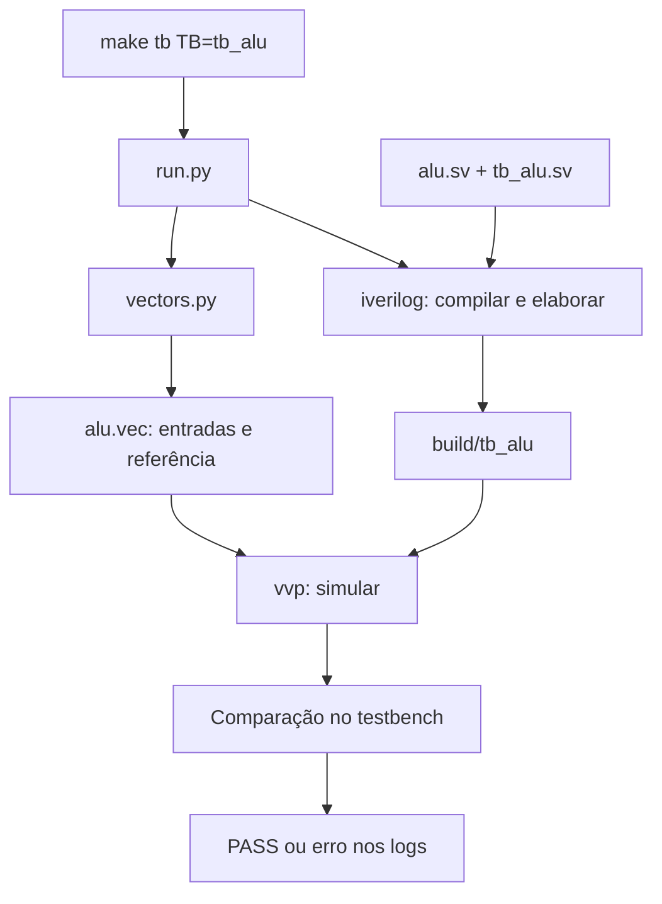

# 1 — Visão geral do ambiente

[Índice](README.md) · [Próxima: testes unitários](02-testes-unitarios.md)

## Objetivo

Identificar quem descreve o circuito, quem o estimula e quem decide se o resultado
está correto. RTL e testbench podem ser desenvolvidos juntos a partir do contrato
do bloco; a ordem de estudo aqui começa por um RTL que já existe.

## Arquivos envolvidos

| Arquivo ou diretório | Responsabilidade |
|---|---|
| [rtl/alu.sv](../../rtl/alu.sv) | função combinacional que será sintetizada |
| [tb/unit/tb_alu.sv](../../tb/unit/tb_alu.sv) | aplica entradas e compara saídas em simulação |
| [scripts/sim/vectors.py](../../scripts/sim/vectors.py) | calcula entradas e referências numéricas |
| [scripts/regression/run.py](../../scripts/regression/run.py) | chama ferramentas e verifica sucesso |
| [Makefile](../../Makefile) | associa nomes de comandos às receitas |
| `build/` | vetores, ROMs e executáveis de simulação recriáveis |
| [results/logs/](../../results/logs/) | comandos executados e resultados |

## Explicação



O simulador executa um modelo do circuito ao longo do tempo. Isso permite conferir
o comportamento antes da fabricação. A síntese, em outra etapa, transforma o RTL
em uma rede de células lógicas. Aprovação na simulação não garante área ou timing.

Python e Make executam no computador de desenvolvimento. O firmware é diferente:
ele é compilado para RISC-V e executado pelo core simulado. O testbench observa essa
execução e verifica, por exemplo, uma assinatura escrita em memória.

## Execução guiada

Inspecione a receita sem executar os testes:

```bash
make -n tb TB=tb_alu
python3 scripts/regression/run.py --help
```

O primeiro comando deve imprimir `python3 scripts/regression/run.py --test tb_alu`.
O segundo apresenta os modos disponíveis. Abra o Makefile e localize exatamente
a linha impressa. Não é o Make que calcula o resultado da ALU.

## Exercício e critério para avançar

Identifique os quatro papéis: quem calcula a referência, quem calcula a saída do
circuito, quem compara e quem inicia as ferramentas.

Resposta: `vectors.py`, `alu.sv`, `tb_alu.sv` e `run.py`, respectivamente. O Makefile
fornece a receita que inicia `run.py`. Avance quando conseguir explicar essa cadeia.
