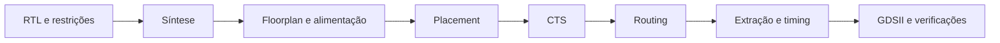

# 7 — Ambiente físico e preparação do simple_system

[Anterior](06-regressao-e-evidencias.md) · [Índice](README.md)

## Objetivo e arquivos

Conectar a verificação funcional à implementação física, validar a infraestrutura
já configurada e entender o próximo experimento. Leia
[environment.sh](../../scripts/openlane/environment.sh) e
[o registro do ambiente](../../docs/openlane/environment.md).

## O que muda ao ir para o fluxo físico

Na simulação verificamos a função do RTL. No fluxo físico, a síntese mapeia o RTL
para células do PDK e as etapas seguintes organizam células e fios em um layout.



| Etapa | O que observar |
|---|---|
| Síntese | células, área estimada, latches e sinais sem uso |
| Floorplan/PDN | área do die, pinos, linhas de células e alimentação |
| Placement | posições legais, densidade e congestionamento |
| CTS | distribuição do clock e seu efeito no timing |
| Routing | fios/vias e violações de geometria |
| Extração/STA | atrasos considerando parasitas e restrições |
| DRC/LVS/antena | regras geométricas, equivalência layout/netlist e checagem de antena |

Testbenches não entram na lista de fontes sintetizadas. O fluxo requer um top
sintetizável, clock, restrições, área e PDK. GDSII gerado sozinho não significa
verificações aprovadas; é necessário ler os relatórios finais.

## Entenda o wrapper existente

O Makefile chama `scripts/openlane/environment.sh`. O script verifica Docker e usa
a imagem `isaiassh/unic-cass-tools:1.1.0`, com `PDK=sky130A` e `PDK_ROOT=/opt/pdks`.
Na instalação atual a imagem contém LibreLane, derivado do OpenLane 2.

O clone atual é montado em `/home/designer/shared/cmos-riscv`, mesmo que tenha outro
nome no host. Os scripts auxiliares estão neste repositório, em `scripts/openlane/`.
Com Docker disponível, `make setup-openlane` baixa a imagem com ferramentas e PDK.
Veja [a instalação completa](../../docs/setup.md).

`--rm` remove o contêiner temporário após sair. Arquivos gravados na montagem
compartilhada persistem; arquivos de `/tmp` do contêiner não persistem.
O script usa um array Bash para preservar cada argumento do Docker.

## Prática executável agora

No terminal do host, na raiz do projeto, com Docker disponível:

```bash
make -n openlane-env-check
make openlane-env-check
make openlane-env-smoke
```

O verificador deve terminar com `AMBIENTE COMPLETO`. O smoke deve terminar com
`Smoke test passed.`. O registro anterior obteve 80/80 etapas com DRC, LVS e antena
PASS; duração e mensagens podem variar no ambiente.

Esse smoke usa o circuito embutido do LibreLane. Seus resultados temporários
não são o GDSII do RISC-V e não são conservados pelo wrapper atual. Leia a saída
final, inclusive os avisos; falha no Docker/PDK é um problema de ambiente a resolver
antes de investigar RTL.

Para explorar o ambiente sem iniciar um projeto físico:

```bash
make openlane-shell
```

Dentro do contêiner:

```bash
pwd
bash scripts/openlane/librelane.sh --version
bash scripts/openlane/librelane.sh --help
exit
```

## Próxima prática planejada: simple_system

O sistema mínimo será um experimento próprio, com core, memórias e uma indicação
observável de sucesso/falha. Ele ainda não foi implementado neste laboratório.
Antes de escrever a configuração física, precisaremos fechar estes contratos:

1. **Top e interface:** clock, reset, sucesso/falha e quais sinais de observação
   ficam só no TB. As saídas precisam observar trabalho real do processador para
   que a síntese não elimine o circuito por falta de efeito externo.
2. **Memórias:** tamanhos, inicialização, latência, byte enables e forma física.
   Preservar bases IMEM `0x00400000` e DMEM `0x10010000`, registrando qualquer
   diferença de capacidade em relação ao sistema de referência.
3. **Firmware:** linker, pilha e assinatura compatíveis com as memórias escolhidas.
   O smoke atual usa assinatura em `0x10011ff0`; reduzir a RAM exige adaptar e
   documentar software e teste, sem apenas diminuir um parâmetro.
4. **Teste autoverificável:** boot, cálculo, assinatura, timeout, reset e falha.
   A solução de inicialização precisa ser implementável fisicamente, não depender
   apenas de valores que o simulador fornece em `initial`.
5. **Configuração física:** arquivos RTL explícitos, top, clock, restrições e área.
   Primeiro validar a síntese e a presença do circuito esperado na netlist.
6. **Execução progressiva:** floorplan, PDN, placement, CTS, routing e verificações;
   registrar configuração, commit, avisos, erros, área, densidade e etapa alcançada.

A IMEM padrão representa 4 MiB. Seu modelo comportamental não oferece automaticamente
uma macro ROM/SRAM física; mapear memórias grandes em células pode inviabilizar o
fluxo. Memórias pequenas inferidas ou macros precisam ser escolhidas e verificadas.

O experimento futuro serve ao aprendizado autorizado nesta sequência. A entrega
final continua seguindo [AGENTS.md](../../AGENTS.md): ISA 47/47, firmware oficial,
interface final e regressão antes de declarar os marcos físicos da competição.

## Exercício e critério de conclusão

Explique a diferença entre `make smoke` e `make openlane-env-smoke`.
O primeiro simula quatro integrações do nosso RTL; o segundo executa fisicamente
um circuito de exemplo do ambiente. Ao terminar, você deve saber executar ambos
e identificar qual circuito e qual propriedade cada resultado valida.
