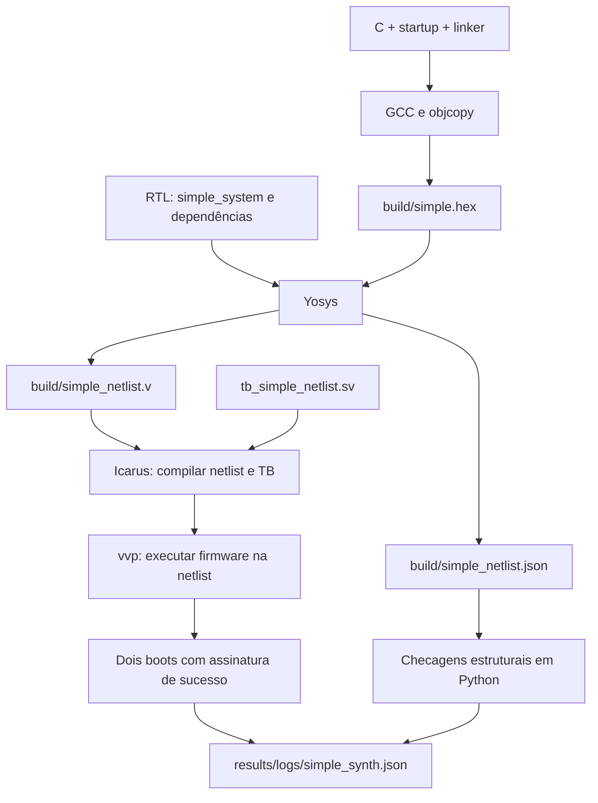

# 7 — Síntese: do RTL à netlist executável

[Anterior](06-regressao-e-evidencias.md) · [Índice](README.md) · [Próxima](08-introducao-openlane.md)

## Objetivo e arquivos

Transformar o RTL do `simple_system` numa rede de portas/registradores e executar
o mesmo firmware nessa rede. Ao terminar, você deve conseguir localizar a entrada
da síntese, a netlist produzida, o teste que a verifica e o relatório da rodada.

| Arquivo | Papel nesta aula |
|---|---|
| [rtl/simple_system.sv](../../rtl/simple_system.sv) | top: core, ROM, RAM e saídas done/success/fault |
| [firmware/simple/](../../firmware/simple/README.md) | C, startup e linker para ROM 2 KiB/RAM 1 KiB |
| [build_simple.py](../../scripts/sim/build_simple.py) | compila o programa e gera `build/simple.hex` |
| [simple.py](../../scripts/synth/simple.py) | chama Yosys, verifica a estrutura e simula a netlist |
| [tb_simple_system.sv](../../tb/integration/tb_simple_system.sv) | verifica o sistema descrito em RTL |
| [tb_simple_netlist.sv](../../scripts/synth/tb_simple_netlist.sv) | verifica a netlist observando seus pinos |
| [Makefile](../../Makefile) | organiza essas chamadas em alvos |

## O que entra e o que sai

Na simulação RTL, o simulador interpreta os módulos originais. Na síntese,
Yosys elabora esses módulos, resolve parâmetros, transforma processos em lógica
e otimiza o circuito. O resultado é uma **netlist**, que descreve células e conexões.
Ela também pode ser simulada.



Neste experimento, a ROM vira lógica constante e a RAM vira registradores/muxes.
As células são genéricas: ainda não são células SKY130A com área e atraso
caracterizados. Os testbenches entram somente na simulação, após a síntese.

## Preparação

Execute na raiz do projeto, um comando por vez:

```bash
make help
make doctor
make simple-system
```

`doctor` deve encontrar Yosys, Icarus, Python e a toolchain RISC-V.
Se faltar uma ferramenta, siga [a instalação](../../docs/setup.md).
O teste RTL deve terminar com `PASS simple_system`, cobrindo boot, reset,
assinatura incorreta e instrução inválida. O CRC usado aqui segue o
[contrato oficial Xicrc](../../docs/architecture/crc.md).

Para fechar uma alteração funcional antes de sintetizar, use também
`make regression`: são 32 TBs e lint. Fazer esta aula não exige reescrever os módulos.

## Execução automática

Primeiro observe o que Make vai executar:

```bash
make -n simple-synth
```

Devem aparecer duas chamadas, com `python3` ou `.venv/bin/python`:

```text
python3 scripts/sim/build_simple.py
python3 scripts/synth/simple.py
```

Isso acontece porque o alvo tem uma dependência:

```make
simple-synth: simple-firmware
	$(PYTHON) scripts/synth/simple.py
```

O Make executa `simple-firmware` antes da receita de síntese, garantindo que a
ROM corresponde ao programa atual. Agora execute:

```bash
make simple-synth
```

O terminal deve informar build do firmware, `PASS simple_netlist` para dois boots
e `PASS simple synthesis`. Se falhar, leia o log indicado antes de avançar.

## O que o script faz

Siga `main()` em `scripts/synth/simple.py`:

| Comando/ação | Finalidade |
|---|---|
| `read_verilog -sv -defer` | lê SystemVerilog e adia a elaboração até conhecer o top/parâmetros |
| `hierarchy -check -top simple_system` | escolhe a raiz e verifica módulos referenciados |
| `synth -top simple_system -flatten` | sintetiza, otimiza e reúne a hierarquia na netlist do top |
| `check -assert` | faz checagens estruturais; problemas detectados encerram a síntese |
| `stat` | mostra contagem e tipos de células |
| `write_verilog -noattr` | grava a netlist Verilog sem os atributos internos do Yosys |
| `write_json` | grava a estrutura com atributos para as checagens Python |
| checagens Python | rejeitam memória não mapeada, init em registradores e saídas constantes |
| `iverilog` + `vvp` | compilam netlist/TB e executam o teste de firmware |

O script também exige lógica sequencial, registra versão/hashes e limita cada
processo a 180 segundos. `check -assert` verifica estrutura; a execução no testbench
é que confere o comportamento observado. Os dois boots não são uma prova formal
de equivalência para todas as entradas.

## Ler os resultados

```bash
cat results/logs/simple_build.log
cat results/logs/simple_netlist.log
python3 -m json.tool results/logs/simple_synth.json
```

| Saída | O que consultar |
|---|---|
| `build/simple.hex` | 512 palavras da ROM; programa e padding com zeros |
| `build/simple_netlist.v` | circuito sintetizado, usado na simulação seguinte |
| `build/simple_netlist.json` | estrutura completa de células, conexões e atributos |
| `results/logs/simple_synth.log` | comandos, etapas Yosys, estatísticas e avisos |
| `results/logs/simple_netlist.compile.log` | compilação da netlist junto do TB |
| `results/logs/simple_netlist.log` | execução dos dois boots e PASS ou falha |
| `results/logs/simple_synth.json` | resumo: status, versão, células, simulação e hashes |

Observe `status: PASS`, `netlist_simulation: PASS`, `cells`, `cell_types` e `scope`.
Na [rodada registrada](../../results/experiments/simple/README.md), Yosys 0.39+124
produziu 32922 células genéricas; o firmware ocupou 608 de 2048 bytes de ROM.
Versões de ferramentas e alterações legítimas podem mudar as contagens.
Não use esse número como área física, frequência máxima ou consumo de potência.

`build/` é regenerável. Os logs são sobrescritos pela próxima rodada; um JSON
antigo com PASS só caracteriza os hashes daquela execução. `make simple-synth`
produz seu próprio resumo e não atualiza a cobertura de ISA nem substitui
`make regression`.

## Execução manual para entender as ferramentas

Esta prática é opcional depois do fluxo automático. Ela grava arquivos `lab_*`
em `build/`, para facilitar a comparação com a saída do script. Primeiro gere a ROM:

```bash
make simple-firmware
```

Execute Yosys com a sequência equivalente à usada pelo script:

```bash
yosys -l build/lab_simple_synth.log -p '
  read_verilog -sv -defer rtl/*.sv;
  hierarchy -check -top simple_system;
  synth -top simple_system -flatten;
  check -assert;
  stat;
  write_verilog -noattr build/lab_simple_netlist.v;
  write_json build/lab_simple_netlist.json
'
```

`-p` recebe os comandos Yosys e `-l` salva o log. `rtl/*.sv` fornece os módulos;
`hierarchy` seleciona `simple_system` e suas dependências. Nenhum arquivo `tb/*.sv`
é sintetizado. Agora compile e simule somente a netlist e sua bancada:

```bash
iverilog -g2012 -s tb_simple_netlist -o build/lab_tb_simple_netlist build/lab_simple_netlist.v scripts/synth/tb_simple_netlist.sv
vvp build/lab_tb_simple_netlist
```

Resultado esperado: `PASS simple_netlist: two boots with ROM constants and uninitialized RAM`.
Não acrescente o RTL original a essa compilação: a netlist já define `simple_system`.
Essa execução manual demonstra as ferramentas; as checagens Python e o resumo
padronizado são executados pelo alvo `make simple-synth`.

## Por que as memórias merecem atenção

Um arquivo `.hex` não é carregado automaticamente em um chip fabricado. Aqui
Yosys resolve o conteúdo da ROM na síntese. Trocar firmware exige sintetizar
novamente. A RAM começa indefinida; o startup copia `.data` e limpa `.bss`.

Foi encontrada uma diferença real entre RTL e síntese: zerar a IMEM antes de
`$readmemh` fazia a ROM sintetizada perder o programa. A implementação agora
escolhe arquivo OU zeros. O gerador preenche todas as palavras e o teste da netlist
verifica que o programa permanece executável depois da transformação.

## Investigação de falhas

| Situação | Primeira investigação |
|---|---|
| Yosys ausente | `make doctor` e instalador |
| `simple ROM exceeds 2 KiB` | tamanho do programa e limites do linker |
| erro Yosys | primeiro erro em `simple_synth.log`; top, fontes e arquivo ROM |
| memória não mapeada / init de registrador | estrutura em `build/simple_netlist.json` e implementação das memórias |
| `netlist fault` ou `netlist firmware failed` | compare com `make simple-system`; confira ROM, reset e síntese |
| `netlist timeout` | clock/reset, execução do programa e endereço da assinatura |

## Exercício e critério para avançar

1. Qual arquivo contém o circuito sintetizado? `build/simple_netlist.v`.
2. O que garante que ele executou o programa? O TB com dois boots e a assinatura
   de sucesso, registrado em `simple_netlist.log`.
3. Onde está a área SKY130A? Ainda não há essa medição; `cells` conta células genéricas.
4. Por que não compilar a netlist junto do RTL original? Ambos definem o mesmo top.

Avance quando souber explicar cada seta do diagrama e obter síntese e teste da
netlist em PASS. A aula seguinte prepara o ambiente para a implementação física.
